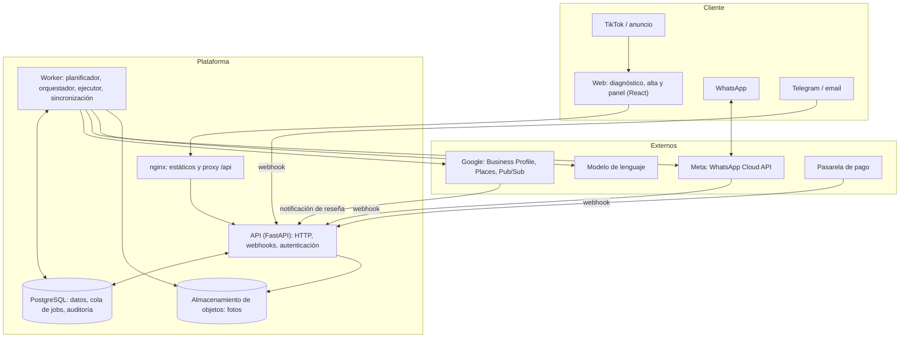
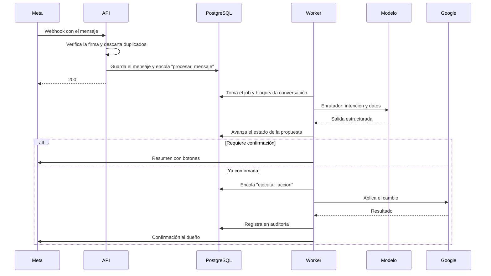

# Diseño de alto nivel (HLD)

## 1. Principios

1. **El modelo propone, el código ejecuta.** El modelo de lenguaje devuelve una acción estructurada y validada. Solo el ejecutor escribe en Google, y solo con una confirmación registrada del dueño (o una regla explícita de modo automático).
2. **Todo lo que escribe un tercero es dato.** Reseñas, nombres de clientes y contenido web nunca se tratan como instrucciones.
3. **Los canales son adaptadores.** La lógica conversacional no sabe si habla por WhatsApp, Telegram, email o el panel.
4. **Todo trabajo asíncrono es un job** en una cola duradera, idempotente y reintentable.
5. **Aislamiento por cuenta** en la base de datos, con seguridad a nivel de fila como segunda barrera.
6. **Cada servicio externo tiene un adaptador y un doble falso**, para poder probar todo en local sin Google, Meta ni el modelo.

## 2. Arquitectura



La API **no** llama a Google, a Meta ni al modelo: valida, guarda y encola. El worker hace todo el trabajo lento o con efectos externos. Así un webhook responde en milisegundos y ningún fallo externo tumba la API.

## 3. Componentes

| Componente | Responsabilidad | No hace |
|---|---|---|
| **Web** | Diagnóstico público, alta, conexión con Google, panel (propuestas, reseñas, historial, métricas, ajustes) | Lógica de negocio |
| **API** | Autenticación, endpoints del panel, recepción y verificación de webhooks, encolado | Llamadas a servicios externos |
| **Planificador** (worker) | Cada día decide qué propuestas tocan: fechas clave, mejoras de la ficha, resúmenes | Enviar mensajes |
| **Orquestador conversacional** (worker) | Recibe un mensaje, carga el estado, enruta la intención, invoca al agente adecuado y avanza la máquina de estados | Escribir en Google |
| **Agentes** (worker) | Enrutador, extractor, experto, redactor y crítico. Entrada y salida estructuradas | Efectos externos |
| **Ejecutor** (worker) | Aplica acciones confirmadas en Google con idempotencia y reintentos | Decidir qué hacer |
| **Pasarela de canales** (worker) | Traduce un mensaje interno al formato de cada canal; gestiona la ventana de 24 horas y las plantillas | Lógica conversacional |
| **Conector de Google** | OAuth, fichas, horarios, reseñas, posts, fotos, métricas, notificaciones | — |
| **Servicio de calendario** | Festivos nacionales, autonómicos y locales, fechas comerciales y reglas de relevancia por sector | — |
| **Base de conocimiento** | Identidad y voz del negocio, aprendizajes, y conocimiento experto de GBP y SEO local versionado | — |
| **Facturación** | Suscripciones, límites del plan, estado de pago | — |

## 4. Comunicación entre servicios

### Mensaje entrante de WhatsApp



### Reglas de comunicación

- **Entrada:** siempre por la API, con firma verificada (Meta, pasarela de pago) o token de identidad (Pub/Sub de Google).
- **Entre API y worker:** solo a través de la cola en PostgreSQL. No hay llamadas directas.
- **Orden:** los mensajes de una misma conversación se procesan de uno en uno, con bloqueo por conversación.
- **Idempotencia:** cada mensaje entrante y cada acción llevan una clave única. Un webhook repetido o un reintento no duplican nada.

## 5. Escalabilidad

| Aspecto | Diseño |
|---|---|
| API | Sin estado; se escala en horizontal detrás de nginx |
| Worker | Varios procesos toman jobs con `SKIP LOCKED`; se añaden procesos según la cola |
| Cola | PostgreSQL hasta que el volumen lo justifique. La interfaz de la cola permite cambiar a un broker sin tocar el dominio |
| Cuotas de Google | 300 consultas por minuto por proyecto. Limitador central, prioridad a las escrituras confirmadas, sincronización por notificaciones y no por sondeo |
| Coste del modelo | Modelo pequeño para enrutar y extraer; modelo mayor solo para redactar. Caché del prefijo del prompt. Tope de gasto por cuenta |
| Planificador | Trabaja por lotes y por zona horaria; ninguna consulta recorre todas las cuentas a la vez |

Orden de magnitud: 5.000 negocios con 3 mensajes al día son unos 15.000 mensajes diarios, menos de uno por segundo de media. PostgreSQL y dos workers lo cubren con margen. El límite real es la cuota de Google, no el cómputo.

## 6. Seguridad

| Riesgo | Control |
|---|---|
| Robo de tokens de Google | Cifrados en la base; la clave solo la tiene el worker. Ámbito mínimo. Revocación al dar de baja. Tras una reconexión, la primera sincronización correcta borra los tokens que la nueva conexión sustituye (no los revoca: Google revocaría la concesión entera y cortaría la conexión nueva) |
| Alguien ordena cambios desde otro teléfono | Vinculación con código de un solo uso generado en la sesión web. Cambios sensibles (teléfono, dirección, categoría) piden confirmación adicional en el panel |
| Webhooks falsos | Verificación de firma y descarte de repetidos por identificador |
| Inyección de instrucciones desde reseñas o webs | Contenido de terceros delimitado y marcado como dato; salida del modelo validada contra esquema; lista cerrada de acciones; confirmación humana |
| Fuga entre cuentas | Seguridad a nivel de fila por cuenta; pruebas que intentan leer datos de otra cuenta |
| Acción no deseada del modelo | El modelo no tiene herramientas de escritura. Toda acción pasa por validación, confirmación y ejecutor |
| Abuso del diagnóstico público | Límite por IP (en memoria) y tope diario para todos los clientes juntos (en PostgreSQL, `usage_counter`, que un disparador solo deja subir de uno en uno), comprobados antes de llamar a Google o al modelo. La captura se rechaza por límite antes de leer su cuerpo. Caché por ficha y captcha si hay abuso |
| Datos personales (RGPD) | Nombres de autores de reseñas y teléfonos: minimización, plazo de conservación, contrato de encargo con cada proveedor, alojamiento en la UE, borrado al dar de baja |
| Secretos | Solo en variables de entorno inyectadas en el despliegue; nunca en el repo ni en logs |
| Trazabilidad | Auditoría inmutable: quién confirmó, qué se envió a Google y qué respondió |
| La API o la conversación comprometidas ordenan un cambio en Google | Ver el riesgo residual siguiente |
| La API comprometida da de baja a otro cliente | Ver el riesgo residual siguiente |
| La API comprometida desactiva fichas o toca propuestas de otro cliente | Ver el riesgo residual siguiente |
| La API comprometida guarda una conexión de Google falsa para otro cliente | Ver el riesgo residual siguiente |
| Un rol de la aplicación tapa una tabla con una tabla temporal y se salta los disparadores (M6) | Cerrado: sin `TEMPORARY` sobre la base para `PUBLIC` ni para los roles de la aplicación, y `search_path = pg_catalog, public, pg_temp` en todas las funciones de la base. Ver «Tablas temporales y `search_path`» |

### Riesgo residual: la API y la conversación atestiguan la confirmación del dueño

Dos roles registran que el dueño ha confirmado algo, y los dos pueden insertar filas en `action`, en `audit_log` (`reply_confirmed`, `special_hours_confirmed`) y en `job`:

- `fichaitor_api`, desde el panel: respuestas a reseñas y, desde las fechas clave (2026-11-12), el horario especial de un día (`set_special_hours`, con `special_date`).
- `fichaitor_conversation`, desde Telegram: lo mismo, con las mismas consultas (hallazgo I11 de `docs/seguridad/revision-2026-11-12-b.md`).

El worker escribe en Google lo que dice la acción. Quien consiga ejecutar SQL con el usuario de cualquiera de los dos puede, por tanto, crear una acción que nadie ha confirmado: publicar una respuesta o cambiar el horario de un día en la ficha de otro cliente.

Lo que lo acota (hallazgo M1 de `docs/seguridad/revision-2026-11-12.md`):

- Al tomar la acción, el worker comprueba en la misma sentencia que la cuenta tiene ese usuario de Google, que la ficha es de esa cuenta y sigue activa, que la cuenta no está dada de baja y, en una respuesta, que la reseña es de ese usuario y esa ficha. Si algo no casa, la acción acaba `fallida` (`internal`) sin llamar a Google y queda su fila de auditoría.
- No es una clave foránea a propósito: la acción, con su texto, se conserva 12 meses y la reseña, 30 días desde la baja.
- Cada rol solo encola los tipos de job que encola su código, con claves de su tipo (B9 y B10).
- La API solo cambia propuestas de fechas clave (y cancela las demás por una baja) y solo libera hilos de la conversación; nunca apunta un hilo a otra propuesta (políticas de fila en `db/schema_channels.sql`). Sus sentencias filtran siempre por la cuenta de la sesión, pero eso solo limita al código honrado: la base no sabe para qué cuenta trabaja la API en cada petición, así que con SQL arbitrario esas políticas valen para cualquier cuenta (ver «La API cambia el estado de otras cuentas», más abajo).

Lo que sigue siendo posible: una acción **coherente** para la cuenta de otro cliente. Con `SELECT` sobre `account`, `location` y `review` (la conversación, también sobre `profile_summary`), los dos roles conocen los identificadores de todos y pueden escribir una acción que pase la comprobación: una respuesta a una reseña real o un horario especial para un día cualquiera de una ficha activa. Ninguna barrera de la base distingue esa fila de una confirmación real, porque la confirmación la atestigua el propio rol.

Para detectarlo: cada `reply_sent` y cada `special_hours_sent` de `audit_log` debe tener antes su `reply_confirmed` o `special_hours_confirmed` con el mismo `action_id`, escrito (`written_by`) por `fichaitor_api_prod` o por `fichaitor_conversation_prod`. Una alerta sobre las que no lo tengan, sobre las confirmadas por un usuario distinto de esos dos, o sobre picos de confirmaciones por cuenta o por rol, queda pendiente.

Esa detección no distingue una confirmación falsificada **a través del canal** (I15 de `docs/seguridad/revision-2026-11-12-c.md`). La API lee `channel_identity.address` (el chat de cada cuenta) y `proposal.step_token`, y puede encolar `channel_inbound` con una actualización de Telegram inventada: la conversación la atiende como si viniera de ese chat, y la confirmación queda escrita por `fichaitor_conversation_prod`, como una real. Desde las fechas clave alcanza también el horario de un día de la ficha. Con SQL de la API también se pueden ocupar claves `telegram:<update_id>` futuras, y entonces se descartan las actualizaciones reales que lleguen con ese número. Es la misma capacidad de arriba (la API ya puede crear la acción directamente) por otro camino. Riesgo aceptado. Si se quiere cerrar: que la API no lea `address` ni `step_token` (privilegios de columna) y que el webhook firme la carga del job con un secreto que solo comparten la API y la conversación, y que la conversación lo verifique.

### Riesgo residual: la API programa la baja de una cuenta

La API programa las bajas (`INSERT` en `offboarding`). Desde M5 de `docs/seguridad/revision-2026-11-12-b.md`, la base solo admite una baja cuyo usuario de Google sea el de esa cuenta y con al menos 47 horas por delante (disparador `offboarding_guard`), y el worker no hace efectiva ninguna que no cumpla eso. Lo que queda: con SQL de la API se puede programar la baja de otra cuenta a 48 horas. El dueño la ve programada al entrar en el panel (y su chat deja de recibir propuestas) y la puede restaurar; no recibe el correo de la baja, porque lo encola la propia API. Para detectarlo: bajas confirmadas sin un `offboarding_code` usado de la misma cuenta en los minutos anteriores.

Entre el 12 de noviembre y la corrección de M6, una tabla temporal `pg_roles` hacía creer al disparador que la API era el propietario, y se aceptaba la baja inmediata. Ya no (ver «Tablas temporales y `search_path`»).

La baja por correo (`scripts/baja_manual.py`, solo con el usuario propietario) también se programa 48 horas, con el correo de baja programada y su enlace de restauración a la dirección de la cuenta (B15). La baja inmediata (`--inmediata`) queda para casos excepcionales, con el visto bueno del responsable, y se tramita solo si el correo de la petición trae `dmarc=pass` alineado con el dominio del `From:` (procedimiento en `docs/despliegue.md`).

### Riesgo residual: la API cambia el estado de otras cuentas

Hallazgo B16 de `docs/seguridad/revision-2026-11-12-c.md`. Para servir el panel, la API tiene privilegios que, con SQL arbitrario y su usuario, alcanzan a cualquier cuenta, porque la base no puede atarlos a la cuenta de la sesión:

- **Desactivar cualquier ficha** (`UPDATE (active_since, plan)` en `location`, sin política de fila). El disparador solo comprueba los límites al activar. La ficha deja de sincronizarse y de proponerse por el chat, y lo obtenido de Google de esa ficha se borra a los 30 días de `deactivated_at`, sin aviso: no es una baja programada que el dueño vea al entrar. Lo arregla volver a activarla antes de los 30 días.
- **Cancelar las propuestas de respuesta** de cualquier cuenta (política `proposal_api_update`: `state = 'cancelada'` con `outcome_reason` `offboarding` o `location_inactive`) y **cambiar estado, testigo y confirmación de cualquier fecha clave** ajena. Una fecha clave confirmada así no basta para escribir en Google: hace falta además la acción, que es el riesgo de «atestiguan la confirmación», arriba.
- **Liberar cualquier hilo o carril** (`conversation_api_release`, `conversation_lane_api_release`): la propuesta no se pierde; el carril la vuelve a entregar.

No pueden: activar fichas por encima de los derechos ni en una cuenta de baja (el disparador lo comprueba con la cuenta bloqueada), escribir derechos ni el registro de activaciones, ni apuntar un hilo o un carril a otra propuesta.

El registro de activaciones (`location_activation_log`) guarda cada desactivación con `written_by` (el usuario de la base) y `reason`. Desde B16, `reason` solo se toma de `fichaitor.activation_reason` si quien escribe es el propietario (o un superusuario): la aplicación nunca lo pide, y si lo pide otro rol queda `untrusted` («no fiable»), no lo que pidió. Así una desactivación ajena no puede quedar registrada como `removed` o `migration`. `written_by` sigue siendo el mismo usuario que en las desactivaciones legítimas.

Para detectarlo: desactivaciones (`event = 'deactivated'`, `written_by = 'fichaitor_api_prod'`) sin una petición HTTP autenticada de la misma cuenta a la ruta de desactivar en ese minuto (registro de acceso de la API); cualquier fila con `reason = 'untrusted'`; propuestas canceladas con `outcome_reason = 'offboarding'` sin una baja confirmada de esa cuenta; picos de desactivaciones por hora. Ninguna alerta está montada todavía. La barrera de verdad sería avisar al dueño por correo de cada desactivación, como de una baja: pendiente.

### Riesgo residual: la API guarda conexiones de Google para cualquier usuario

Hallazgo B14 de `docs/seguridad/revision-2026-11-12-c.md`. La API inserta en `google_connection` (es quien recibe el OAuth) y tiene la clave pública que sella los tokens, así que con SQL puede guardar una conexión para el `google_sub` de cualquiera, con el token que quiera. Vale siempre la más reciente válida de cada usuario.

Lo que lo acota:

- **Una conexión que falla solo se lleva a sí misma.** Ante un `invalid_grant`, el worker revoca solo esa conexión (`revoke_connection`); las anteriores no se tocan y `latest_connection` pasa a la siguiente válida. Antes borraba también las anteriores, y una conexión basura hacía borrar el token real de la víctima y, si no quedaba otro, empezaba la cuenta atrás de 30 días.
- **La API no elige la fecha.** No tiene privilegio sobre `connected_at` (toma `now()`) ni sobre `revoked_at`: no puede colar una conexión «más nueva» que las reconexiones que lleguen después.
- **Las anteriores solo se borran tras un éxito** (`drop_replaced_connections`, en la primera sincronización correcta de la nueva).

Por qué esta opción y no exigir una prueba de origen a la API: la prueba de origen de verdad es que el token sea de ese usuario de Google, y eso solo lo puede comprobar quien lo usa (el worker, preguntando a Google por la identidad del token). Mientras no exista, que el borrado dependa solo del éxito propio de cada conexión es la regla más sólida: un token inventado nunca tiene éxito, así que nunca borra nada que no sea él mismo.

Lo que sigue siendo posible:

- **Molestar sin borrar.** Cada conexión basura hace fallar una sincronización (el panel pide volver a conectar hasta la siguiente) o una acción confirmada (queda `fallida`, `reconnect`). Se arregla solo en la sincronización siguiente o volviendo a conectar.
- **Un token real del atacante.** Con el secreto del cliente OAuth (está en `api.env`), quien controle la API puede obtener un token válido de **su propia** cuenta de Google y guardarlo para el `google_sub` de la víctima, con sus propias fichas en `locations`. Una sincronización de una de esas fichas funciona y borra las conexiones anteriores de la víctima (las reales). No le da acceso a las fichas de la víctima (su token no las lee), pero la víctima tiene que volver a conectar. Para cerrarlo: que el worker compruebe, antes de usar una conexión por primera vez, que la identidad del token (`sub`) coincide con `google_sub`.

Para detectarlo: conexiones revocadas (`google_grant_revoked` en el log) que nunca sincronizaron, y conexiones de un usuario sin un inicio de sesión (`session` nueva) de su cuenta en el mismo minuto.

### Tablas temporales y `search_path`

Hallazgo M6 de `docs/seguridad/revision-2026-11-12-c.md`. PostgreSQL busca tablas y tipos en el esquema temporal de la sesión **antes** que en `pg_catalog` y en `public` si `pg_temp` no aparece en el `search_path`. Con el privilegio `TEMPORARY` (que `PUBLIC` tiene por defecto), la API creaba una tabla temporal `pg_roles` con `rolsuper = true` y todos los disparadores de guardia la trataban como al propietario: baja inmediata de cualquier cuenta, topes a cero, fichas Pro sin derecho. Con una `plan_entitlement` o una `location_activation_log` temporales tapaba los derechos o se llevaba el registro de activaciones, aunque la función fijara `search_path = pg_catalog, public`.

Dos barreras, cada una suficiente:

1. **Ningún rol de la aplicación crea tablas temporales.** Al aplicar `db/schema.sql`, un bloque `DO` retira `TEMPORARY` sobre la base actual (`current_database()`: `fichaitor`, las `_test` o la de producción) a `PUBLIC`, a `fichaitor_api`, `fichaitor_worker` y `fichaitor_conversation` y a sus usuarios. El propietario lo conserva. De paso, nadie más que el propietario crea objetos en `public`. La aplicación no usa tablas temporales.
2. **Todas las funciones de la base** (disparadores, `SECURITY DEFINER` y auxiliares como `fichaitor_is_owner` y `job_key_fits`) fijan `search_path = pg_catalog, public, pg_temp`, con `pg_temp` explícito y el último, y nombran los catálogos con su esquema (`pg_catalog.pg_roles`). Las funciones nunca se buscan en `pg_temp`.

`tests/test_seguridad_c_postgres.py` reproduce los cuatro ataques del informe (con `TEMPORARY` concedido dentro de una transacción que se deshace, para probar la segunda barrera sola) y comprueba que toda función nueva del esquema cumple la regla. Para comprobarlo en producción:

```sql
SELECT has_database_privilege('fichaitor_api_prod', current_database(), 'TEMPORARY');  -- f
```

### Otros riesgos aceptados

- **Reconexión durante la pasada del día 30** (I17). La pasada que borra lo obtenido de Google de un usuario que retiró el acceso bloquea primero la fila de su cuenta y lee las conexiones después. El callback del OAuth guarda la conexión y después escribe la cuenta (`upsert_account`), que espera a ese bloqueo: una reconexión a la vez cancela la pasada. Mitigado.
- **Dos cambios de horario a la vez en la misma ficha** (I21). `set_special_hours` lee de Google la lista entera de horarios especiales y la reescribe con el día cambiado. Con un solo worker (el despliegue actual: un job cada vez) dos fechas de la misma ficha no se pisan. Con varias réplicas, dos cambios a la vez de la misma ficha pueden perder uno y darlo por hecho; y un cambio manual del dueño en Google justo entre la lectura y la escritura se pierde, también con un solo worker. Riesgo aceptado mientras haya un solo worker. Antes de escalar el worker: un bloqueo consultivo por `(google_sub, ficha)` alrededor de la lectura y la escritura.

## 7. Observabilidad

- Logs estructurados con identificador de cuenta, conversación y job.
- Tabla de jobs consultable: pendientes, fallidos, tiempos.
- Métricas de producto: propuestas enviadas, respondidas, aplicadas, tiempo de respuesta del dueño, ediciones.
- Métricas del modelo: coste por cuenta, latencia, tasa de salidas inválidas.
- Alertas: cola atascada, tasa de fallos de Google, plantillas rechazadas, tokens revocados.
