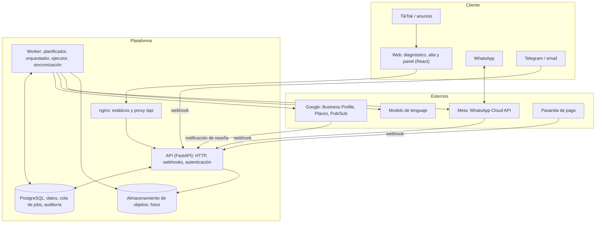
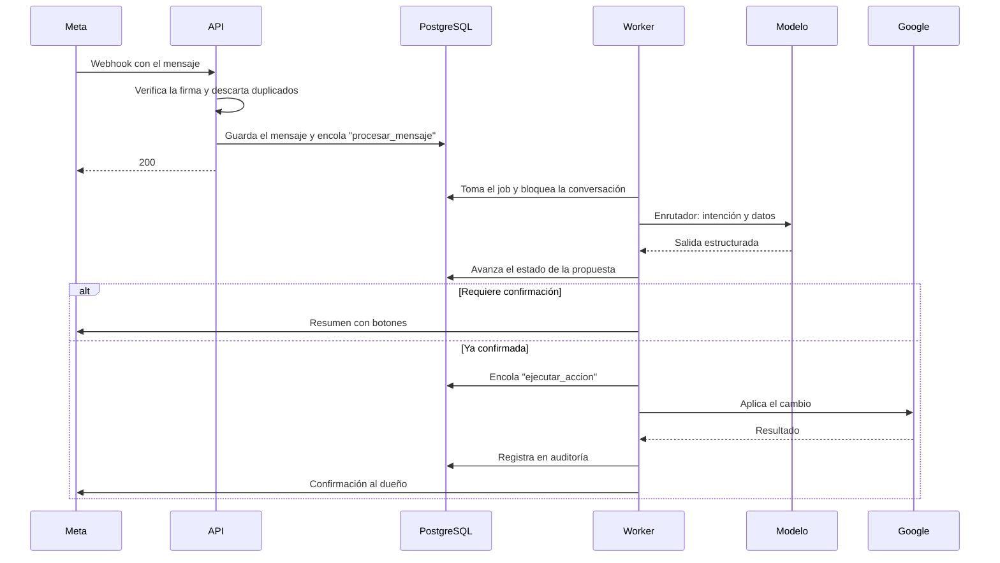

# Diseño de alto nivel (HLD)

## 1. Principios

1. **El modelo propone, el código ejecuta.** El modelo de lenguaje devuelve una acción estructurada y validada. Solo el ejecutor escribe en Google, y solo con una confirmación registrada del dueño (o una regla explícita de modo automático).
2. **Todo lo que escribe un tercero es dato.** Reseñas, nombres de clientes y contenido web nunca se tratan como instrucciones.
3. **Los canales son adaptadores.** La lógica conversacional no sabe si habla por WhatsApp, Telegram, email o el panel.
4. **Todo trabajo asíncrono es un job** en una cola duradera, idempotente y reintentable.
5. **Aislamiento por cuenta** en la base de datos, con seguridad a nivel de fila como segunda barrera.
6. **Cada servicio externo tiene un adaptador y un doble falso**, para poder probar todo en local sin Google, Meta ni el modelo.

## 2. Arquitectura

La API **no** llama a Google, a Meta ni al modelo: valida, guarda y encola. El worker hace todo el trabajo lento o con efectos externos. Así un webhook responde en milisegundos y ningún fallo externo tumba la API.

## 3. Componentes

| Componente | Responsabilidad | No hace |
|---|---|---|
| **Web** | Diagnóstico público, alta, conexión con Google, panel (propuestas, reseñas, historial, métricas, ajustes) | Lógica de negocio |
| **API** | Autenticación, endpoints del panel, recepción y verificación de webhooks, encolado | Llamadas a servicios externos |
| **Planificador** (worker) | Cada día decide qué propuestas tocan: fechas clave, mejoras de la ficha, resúmenes | Enviar mensajes |
| **Orquestador conversacional** (worker) | Recibe un mensaje, carga el estado, enruta la intención, invoca al agente adecuado y avanza la máquina de estados | Escribir en Google |
| **Agentes** (worker) | Enrutador, extractor, experto, redactor y crítico. Entrada y salida estructuradas | Efectos externos |
| **Ejecutor** (worker) | Aplica acciones confirmadas en Google con idempotencia y reintentos | Decidir qué hacer |
| **Pasarela de canales** (worker) | Traduce un mensaje interno al formato de cada canal; gestiona la ventana de 24 horas y las plantillas | Lógica conversacional |
| **Conector de Google** | OAuth, fichas, horarios, reseñas, posts, fotos, métricas, notificaciones | — |
| **Servicio de calendario** | Festivos nacionales, autonómicos y locales, fechas comerciales y reglas de relevancia por sector | — |
| **Base de conocimiento** | Identidad y voz del negocio, aprendizajes, y conocimiento experto de GBP y SEO local versionado | — |
| **Facturación** | Suscripciones, límites del plan, estado de pago | — |

## 4. Comunicación entre servicios

### Mensaje entrante de WhatsApp

### Reglas de comunicación

- **Entrada:** siempre por la API, con firma verificada (Meta, pasarela de pago) o token de identidad (Pub/Sub de Google).
- **Entre API y worker:** solo a través de la cola en PostgreSQL. No hay llamadas directas.
- **Orden:** los mensajes de una misma conversación se procesan de uno en uno, con bloqueo por conversación.
- **Idempotencia:** cada mensaje entrante y cada acción llevan una clave única. Un webhook repetido o un reintento no duplican nada.

## 5. Escalabilidad

| Aspecto | Diseño |
|---|---|
| API | Sin estado; se escala en horizontal detrás de nginx |
| Worker | Varios procesos toman jobs con `SKIP LOCKED`; se añaden procesos según la cola |
| Cola | PostgreSQL hasta que el volumen lo justifique. La interfaz de la cola permite cambiar a un broker sin tocar el dominio |
| Cuotas de Google | 300 consultas por minuto por proyecto. Limitador central, prioridad a las escrituras confirmadas, sincronización por notificaciones y no por sondeo |
| Coste del modelo | Modelo pequeño para enrutar y extraer; modelo mayor solo para redactar. Caché del prefijo del prompt. Tope de gasto por cuenta |
| Planificador | Trabaja por lotes y por zona horaria; ninguna consulta recorre todas las cuentas a la vez |

Orden de magnitud: 5.000 negocios con 3 mensajes al día son unos 15.000 mensajes diarios, menos de uno por segundo de media. PostgreSQL y dos workers lo cubren con margen. El límite real es la cuota de Google, no el cómputo.

## 6. Seguridad

| Riesgo | Control |
|---|---|
| Robo de tokens de Google | Cifrados en la base; la clave solo la tiene el worker. Ámbito mínimo. Revocación al dar de baja. Tras una reconexión, la primera sincronización correcta borra los tokens que la nueva conexión sustituye (no los revoca: Google revocaría la concesión entera y cortaría la conexión nueva) |
| Alguien ordena cambios desde otro teléfono | Vinculación con código de un solo uso generado en la sesión web. Cambios sensibles (teléfono, dirección, categoría) piden confirmación adicional en el panel |
| Webhooks falsos | Verificación de firma y descarte de repetidos por identificador |
| Inyección de instrucciones desde reseñas o webs | Contenido de terceros delimitado y marcado como dato; salida del modelo validada contra esquema; lista cerrada de acciones; confirmación humana |
| Fuga entre cuentas | Seguridad a nivel de fila por cuenta; pruebas que intentan leer datos de otra cuenta |
| Acción no deseada del modelo | El modelo no tiene herramientas de escritura. Toda acción pasa por validación, confirmación y ejecutor |
| Abuso del diagnóstico público | Límite por IP (en memoria) y tope diario para todos los clientes juntos (en PostgreSQL, `usage_counter`), comprobados antes de llamar a Google o al modelo. La captura se rechaza por límite antes de leer su cuerpo. Caché por ficha y captcha si hay abuso |
| Datos personales (RGPD) | Nombres de autores de reseñas y teléfonos: minimización, plazo de conservación, contrato de encargo con cada proveedor, alojamiento en la UE, borrado al dar de baja |
| Secretos | Solo en variables de entorno inyectadas en el despliegue; nunca en el repo ni en logs |
| Trazabilidad | Auditoría inmutable: quién confirmó, qué se envió a Google y qué respondió |
| La API comprometida ordena una respuesta en Google | Ver el riesgo residual siguiente |

### Riesgo residual: la API atestigua la confirmación del dueño

El rol de la API puede insertar filas en `action` y en `job`: es quien registra que el dueño ha confirmado un texto. El worker publica en Google lo que dice la acción. Quien consiga ejecutar SQL con el usuario de la API puede, por tanto, crear una acción que nadie ha confirmado.

Lo que lo acota (hallazgo M1 de `docs/seguridad/revision-2026-11-12.md`):

- Al tomar la acción, el worker comprueba en la misma sentencia que la cuenta tiene ese usuario de Google, que la ficha es de esa cuenta y sigue activa, que la cuenta no está dada de baja y que la reseña es de ese usuario y esa ficha. Si algo no casa, la acción acaba `fallida` (`internal`) sin llamar a Google y queda su fila de auditoría.
- No es una clave foránea a propósito: la acción, con su texto, se conserva 12 meses y la reseña, 30 días desde la baja.

Lo que sigue siendo posible: una acción **coherente** para la cuenta de otro cliente. Con `SELECT` sobre `account`, `location` y `review`, la API conoce los identificadores de todos y puede escribir una acción que pase la comprobación. Ninguna barrera de la base distingue esa fila de una confirmación real, porque la confirmación la atestigua la propia API.

Para detectarlo: cada `reply_sent` de `audit_log` debe tener antes su `reply_confirmed` con el mismo `action_id`, escrito por el usuario de la API. Una alerta sobre las que no lo tengan, o sobre picos de confirmaciones por cuenta, queda pendiente.

## 7. Observabilidad

- Logs estructurados con identificador de cuenta, conversación y job.
- Tabla de jobs consultable: pendientes, fallidos, tiempos.
- Métricas de producto: propuestas enviadas, respondidas, aplicadas, tiempo de respuesta del dueño, ediciones.
- Métricas del modelo: coste por cuenta, latencia, tasa de salidas inválidas.
- Alertas: cola atascada, tasa de fallos de Google, plantillas rechazadas, tokens revocados.
