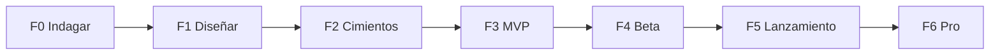

# Roadmap

Seis fases secuenciales. Ninguna empieza sin cumplir el criterio de salida de la anterior. Las duraciones son estimaciones para un desarrollador con asistencia de IA y se revisan al cerrar la fase 0.

## Fase 0. Indagar (2 semanas)

Nada de código de producto. El objetivo es eliminar los riesgos que pueden tumbar el proyecto.

| # | Qué hay que averiguar | Cómo | Resultado |
|---|---|---|---|
| 0.1 | **Verificación de la app de Google** para el ámbito `business.manage`: requisitos, plazos, si exige auditoría de seguridad | Documentación de Google y solicitud real | Solicitud enviada y plazo conocido |
| 0.2 | **Qué permite hoy la API** con el proyecto aprobado: horarios especiales, posts (tipos y límites), fotos, respuesta a reseñas, notificaciones por Pub/Sub, cuotas | Pruebas contra la ficha de Bitclick | Matriz función–endpoint–límite, verificada |
| 0.3 | **WhatsApp:** Cloud API directa o proveedor, categorías y aprobación de plantillas, precio por mensaje en España, límites de botones, número único o por cliente | Documentación de Meta y una plantilla de prueba | Decisión de acceso y coste por negocio y mes |
| 0.4 | **Calendario de festivos locales:** fuente oficial por municipio y forma de actualizarlo cada año | Buscar fuentes abiertas por comunidad autónoma | Fuente elegida y plan de carga |
| 0.5 | **RGPD:** base legal, encargados (Google, Meta, proveedor del modelo), datos de autores de reseñas, alojamiento, textos legales | Revisión con las plantillas de privacidad del despacho | Registro de tratamiento y lista de contratos |
| 0.6 | **Canal de captación:** contactos por contenido orgánico en TikTok (decisión 2026-11-13: sin anuncios por ahora) | Vídeos orgánicos que llevan a fichaitor.es | Contactos y altas por vídeo medidos; los anuncios, más adelante |
| 0.7 | **Disposición a pagar y precio** | 10 conversaciones con dueños (clientes actuales, Juncaril) | Precio de salida y objeciones |
| 0.8 | **Respuesta real del dueño** a las propuestas | PubliExpe en modo aprobación en GBP Autopilot | Porcentaje de respuesta, tiempo y ediciones |
| 0.9 | Nombre, dominio y marca | — | Nombre y dominio registrados |

**Criterio de salida:** la verificación de Google está solicitada, la matriz de la API está confirmada, el coste por negocio es compatible con el precio y el coste por contacto de TikTok no descarta el canal. Si 0.6 o 0.7 fallan, se replantea el modelo antes de invertir en construir.

## Fase 1. Diseñar (2 semanas)

| # | Entregable |
|---|---|
| 1.1 | Constitución del proyecto: principios innegociables (el modelo no escribe, pruebas primero, aislamiento por cuenta) |
| 1.2 | HLD y LLD revisados con lo aprendido en la fase 0 |
| 1.3 | Modelo de amenazas |
| 1.4 | Contrato OpenAPI 3.1 y esquema de la base de datos |
| 1.5 | Guion conversacional completo del MVP: cada mensaje, botón y plantilla |
| 1.6 | Prototipo navegable del alta y del panel |
| 1.7 | **Conjunto de evaluación:** 100–150 mensajes reales de dueños con la intención y los datos esperados, y 50 reseñas con respuesta de referencia |
| 1.8 | Elección del modelo de lenguaje con el conjunto de evaluación: calidad, coste y latencia |
| 1.9 | Plantillas de WhatsApp enviadas a aprobación |

**Criterio de salida:** el guion cubre todos los estados y excepciones de `01-flujos.md`; el modelo elegido supera el umbral acordado en el conjunto de evaluación; las plantillas están aprobadas o en revisión.

## Fase 2. Cimientos (3 semanas)

| # | Entregable |
|---|---|
| 2.1 | Repo, Docker Compose, integración continua con todas las puertas de calidad |
| 2.2 | Base de datos con aislamiento por cuenta y pruebas de fuga entre cuentas |
| 2.3 | Cuentas, sesiones y roles |
| 2.4 | Cola de jobs con reintentos, idempotencia y bloqueo por conversación |
| 2.5 | Adaptadores y dobles falsos: Google, WhatsApp, modelo, pagos |
| 2.6 | Conexión con Google por OAuth y cifrado de tokens |
| 2.7 | Auditoría y logs estructurados |
| 2.8 | Despliegue automatizado a un entorno de pruebas |

**Criterio de salida:** un usuario se da de alta, conecta una ficha real y la ve en el panel; toda la suite pasa en local y en integración continua sin servicios externos.

## Fase 3. MVP (5–6 semanas)

Rebanadas verticales. Cada una se entrega completa, de la base de datos al mensaje.

| # | Rebanada | Incluye |
|---|---|---|
| 3.1 | Vinculación de WhatsApp | Código, bienvenida, pasarela de canales, ventana de 24 horas |
| 3.2 | Motor de propuestas | Máquina de estados, enrutador, extractor, confirmación, ejecutor |
| 3.3 | Fechas clave | Calendario, reglas por sector, planificador, horarios especiales, "hoy cierro" |
| 3.4 | Reseñas | Notificación, análisis, redactor, crítico, aprobación, aprendizaje de voz |
| 3.5 | Diagnóstico público | Nota de la ficha, 5 mejoras, paso al alta |
| 3.6 | Panel | Inicio, bandeja, reseñas, calendario, ajustes |
| 3.7 | Facturación | Suscripción, prueba gratuita, límites del plan |
| 3.8 | Consulta al experto | Respuestas sobre la ficha con sus datos y las notas expertas |

**Criterio de salida:** las pruebas E2E de los cuatro flujos principales pasan; el conjunto de evaluación se mantiene sobre el umbral; Bitclick usa el producto con su propia ficha durante una semana sin incidencias graves.

## Fase 4. Beta cerrada (4 semanas)

10–20 negocios reales, la mitad de hostelería, gratis o a precio reducido.

Se mide:

- Tiempo hasta completar el alta, y dónde se abandona.
- Porcentaje de propuestas respondidas, tiempo de respuesta y ediciones.
- Mensajes no entendidos (alimentan el conjunto de evaluación).
- Coste real por negocio: modelo, WhatsApp, Google.
- Incidencias de seguridad y de calidad de las respuestas.

**Criterio de salida:** más del 70 % completa el alta sin ayuda; más del 60 % de las propuestas recibe respuesta; ningún cambio no confirmado ha llegado a una ficha; la verificación de la app de Google está concedida.

## Fase 5. Lanzamiento (2 semanas y continuo)

- Textos legales, página de precios, soporte y página de estado.
- Campañas de TikTok con el diagnóstico como gancho.
- Alertas y guardia básica.
- Revisión semanal de coste por alta, activación, respuesta y bajas.

## Fase 6. Plan Pro (por rebanadas, según datos de la beta)

> **Decisión del propietario (2026-11-13):** las publicaciones, las fotos, el modo automático y la edición de la información del negocio desde «Qué mejorar» van **después del MVP**. Mientras tanto no se anuncian en la web.

Orden propuesto, a confirmar con lo que pidan los clientes:

0. Información del negocio desde «Qué mejorar»: descripción, web, horario normal y categorías secundarias, con confirmación del dueño.

1. Fotos por WhatsApp: ajuste, texto alternativo, pie y "¿post o solo foto?".
2. Post a partir de un brief por texto o audio.
3. Modo automático para reseñas de 4 y 5 estrellas.
4. Posts periódicos propuestos por el agente.
5. Competencia y comparativa mensual.
6. Informe mensual.
7. Carta del restaurante a partir de una foto.
8. Varias fichas por cuenta. **Hecho** (2026-11-12): pasos 1 a 9 de [multinegocio.md](multinegocio.md).

## Backoffice: precios y ofertas (decidido 2026-11-13)

- Precios y descuento por volumen editables desde el backoffice.
- Ofertas con inicio y fin que cambian el precio que ve la web mientras están vigentes.
- Avisos en el panel como **banner discreto**, creados desde el backoffice con inicio y fin (ver `docs/admin-facturacion.md`, anexo de precios y ofertas).

## Ideas para después del MVP

### Programa "trae 3 y el tuyo es gratis"

Propuesta del propietario (2026-11-11). Hipótesis: el boca a boca entre dueños de negocios es el canal más barato.

- Un cliente recomienda Fichaitor a otros negocios. Cuando consigue **3 contratos nuevos**, su plan pasa a ser gratis.
- **Revisión humana:** el propietario aprueba cada caso antes de aplicar la gratuidad.
- **Una sola vez** mientras dura el contrato del que recomienda.
- **Los 3 contratos deben mantenerse el año completo.** Si alguno se da de baja antes, la gratuidad no se consolida.

Qué hay que definir antes de construirlo:

| Punto | Pregunta |
|---|---|
| Atribución | Código o enlace por cliente. El QR impreso puede llevarlo |
| Momento del premio | Como los contratos son anuales y deben cumplirse enteros, lo natural es premiar la **renovación** del año siguiente, no devolver el año en curso |
| Qué plan se regala | El que tenga el cliente, o solo el Pro (el de WhatsApp tiene coste variable) |
| Fraude | Altas ficticias o de fichas del mismo dueño. La revisión humana lo cubre al principio; con volumen hacen falta reglas |
| Fiscalidad | Un descuento por recomendación a otro negocio puede tener tratamiento fiscal. Consultarlo antes de anunciarlo |
| Datos | Estado por recomendación: pendiente, activa, consolidada, anulada. Encaja con la tabla de suscripciones |

Coste para Fichaitor: un plan gratis (35 o 59 €) a cambio de tres contratos (105 a 177 €). Sale a cuenta si los tres no habrían llegado solos.

## Riesgos del plan

| Riesgo | Señal | Respuesta |
|---|---|---|
| Google tarda o niega la verificación | Sin respuesta en la fase 2 | La beta cabe en el límite de 100 usuarios; el lanzamiento espera |
| Google lanza respuestas con IA nativas en España | Anuncio oficial | El valor se apoya en fechas clave, WhatsApp y experto, no solo en reseñas |
| El dueño no contesta | Menos del 40 % de respuesta en la beta | Revisar frecuencia, horario y texto; ofrecer modo automático antes |
| El coste de captación no sale | Fase 0.6 | Probar contenido orgánico o canal indirecto antes de construir |
| Meta rechaza plantillas | Fase 1.9 | Reformular como utilidad; Telegram y email como alternativa |
| Cambios en la API de Google | Aviso de retirada | Conector aislado y matriz de la fase 0 revisada cada trimestre |
