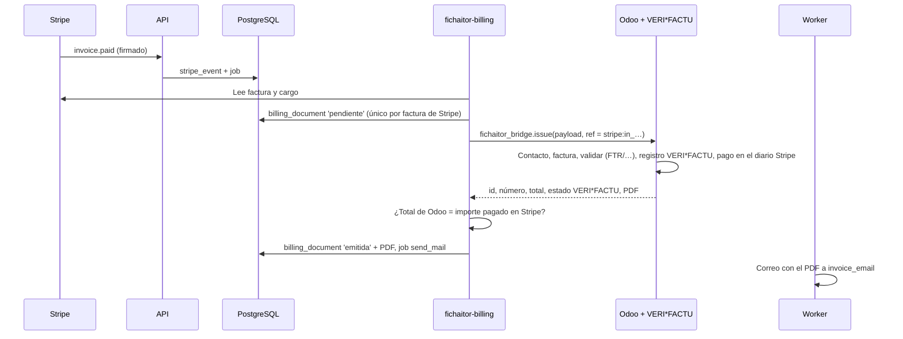

# Plataforma de administración y facturación con Stripe

Diseño e implementación del cobro de Fichaitor con Stripe, de la factura legal en Odoo y del backoffice interno de Bitclick. Fecha: 2026-11-13. Estado: propuesta. Incluye las decisiones del propietario del 2026-11-13, que mandan sobre cualquier recomendación de este documento. Las preguntas que quedan abiertas están en la [sección 9](#9-riesgos-y-preguntas-abiertas).

> **Importante:** Este documento no autoriza a cobrar. Mientras `billing_setting.launch_at` esté vacío, la API responde `pricing.charging: false` y nada cobra. Todas las pruebas usan el modo de prueba de Stripe (`sk_test_` o `rk_test_`) y su CLI. Ningún agente usa claves `live`.

> **Nota sobre las fuentes:** El 2026-11-13, las páginas del BOE y de la sede de la AEAT devolvían un error 403 de Cloudflare a la herramienta de lectura. Las normas se citan con su URL oficial, y su contenido se ha contrastado con fuentes secundarias, también citadas. Los puntos marcados **(gestoría)** debe confirmarlos la gestoría antes del lanzamiento.

## 1. Decisiones

### 1.1 Del propietario (2026-11-13)

| # | Decisión |
|---|---|
| P1 | Stripe cobra. La factura legal se emite en el **Odoo CE de Bitclick**, con su serie y su numeración |
| P2 | **No se devuelve nada cobrado.** Activar una ficha a mitad de año cobra un año entero, hasta su propia renovación. Se puede cancelar cuando se quiera, pero si no se cancela a tiempo se cobra el año completo. Sin prorrateo. Solo hay reembolsos manuales de un administrador, en casos excepcionales. Se mantiene el 5 % desde la segunda ficha de pago |
| P3 | **Impago:** la cuenta queda **bloqueada en ese momento**, sin plazo de gracia, y el usuario recibe un correo. No hay reintentos que mantengan el servicio abierto |
| P4 | Métodos de pago: tarjeta, Bizum y SEPA |
| P5 | Backoffice **solo a través de un túnel al VPS**, sin nada expuesto en Nginx Proxy Manager ni en internet. Usuario y contraseña con **TOTP**, recuperación, auditoría y roles, en un proceso y un rol de base de datos aparte |

### 1.2 De este diseño

| Tema | Decisión | Motivo, en una línea |
|---|---|---|
| Suscripciones | **Una suscripción de Stripe por plaza**, y cada plaza con su propia fecha de renovación. Un solo `Customer` por cuenta | Es la única forma de cumplir P2: Stripe pone una sola fecha de facturación a todos los elementos de una suscripción |
| Plaza y ficha | Una plaza es un año pagado de un plan. Una ficha activa ocupa una plaza. Si la ficha se desactiva, la plaza sigue pagada y libre hasta su renovación | Encaja con `plan_entitlement` (una fila por plaza) y con P2 |
| Descuento del 5 % | 4 precios (`*_first` y `*_additional`). El precio de cada plaza **se fija al cobrarla**, con la regla del propietario sobre las plazas vigentes en ese momento. Se congela en el aviso de renovación a 30 días | Reproduce `plans.price_lines` sin prorrateos, y cumple los 30 días de aviso de cambio de precio (cláusula 7 de las condiciones) |
| IVA | Lo calcula nuestro dominio, con 3 Tax Rates fijos en Stripe y la posición fiscal equivalente en Odoo. **Sin Stripe Tax** | Venta solo B2B con NIF y pocos casos. Así Stripe y Odoo no pueden discrepar |
| Puente con Odoo | Un módulo propio y pequeño, `fichaitor_bridge`, con un único método idempotente que crea, valida y cobra la factura y devuelve el número y el PDF | Una llamada atómica e idempotente, en vez de 6 llamadas sueltas a JSON-2 |
| Bloqueo | Una fila en `account_billing_block`. Todas las barreras (API, worker y conversación) consultan la misma condición en SQL | Mismo patrón que «baja programada» (`_NO_OPEN_LEAVE`) |
| Procesos nuevos | `fichaitor-billing` (rol `fichaitor_billing`, con la clave de Stripe y la de Odoo) y `fichaitor-admin` (rol `fichaitor_admin`, sin claves externas) | Mínimo privilegio. La API solo tiene el secreto de firma del webhook |

## 2. Cumplimiento fiscal en España

### 2.1 A quién se vende y con qué IVA

Las condiciones de uso (cláusula 3) dicen que Fichaitor solo se vende a empresas y a profesionales. Los precios no incluyen IVA (cláusula 6). De ahí salen tres reglas:

1. **El NIF es obligatorio para pagar.** Toda venta es B2B, así que no aplica la ventanilla única (OSS) de ventas a consumidores de la UE.
2. **Siempre se emite factura completa**, nunca simplificada. La simplificada se admite hasta 400 € con IVA incluido (art. 4.1.a del RD 1619/2012), pero el cliente es empresario y necesita su NIF y su domicilio en la factura para deducir el IVA.
3. **Tratamiento fiscal por cliente.** Lo decide la función pura `tax_treatment` de `app/domain/billing.py`:

| Cliente | Cómo se detecta | Tratamiento | Mención en la factura | Tax Rate en Stripe | Posición fiscal en Odoo |
|---|---|---|---|---|---|
| Península o Baleares, con NIF | `ES`, código postal que no empieza por 35, 38, 51 ni 52 | IVA del 21 % | — | `iva_21` | Régimen nacional |
| Canarias, con NIF | Código postal 35 o 38 | No sujeta a IVA: un servicio B2B se localiza donde está el destinatario (art. 69.Uno.1.º LIVA), y Canarias está fuera del territorio del IVA (art. 3 LIVA). El destinatario liquida el IGIC por inversión del sujeto pasivo **(gestoría)** | «Operación no sujeta a IVA (arts. 3 y 69 de la Ley 37/1992)» | `no_sujeto` (0 %) | Canarias o extracomunitario |
| Ceuta y Melilla, con NIF | Código postal 51 o 52 | No sujeta a IVA. El tratamiento del IPSI lo confirma la gestoría **(gestoría)** | La misma mención | `no_sujeto` (0 %) | Extracomunitario |
| Otro país de la UE | — | **No se vende al lanzar** ([pregunta 9](#9-riesgos-y-preguntas-abiertas)) | — | — | — |

### 2.2 Factura completa

Odoo emite la factura con el contenido del art. 6 del RD 1619/2012:

- número y serie;
- fecha de expedición y, si es distinta, la de la operación;
- razón social, NIF y domicilio de BITCLICK SOLUTIONS S.L.U. y del cliente;
- descripción, por ejemplo: «Fichaitor Pro, ficha "Bar La Parra", del 14/03/2027 al 13/03/2028» o «… (segunda ficha y siguientes, 5 % de descuento)»;
- base imponible, tipo y cuota;
- la mención de no sujeción cuando corresponda;
- con VERI\*FACTU, el código QR y la leyenda que pone el módulo.

El pago es anticipado, así que el IVA se devenga al cobrar (art. 75.Dos LIVA). La factura se emite al confirmarse el cobro. Con un destinatario empresario, el plazo legal llega hasta el día 16 del mes siguiente (art. 11 del RD 1619/2012). Ese margen es el que permite tolerar una caída de Odoo ([sección 4.5](#45-si-odoo-no-responde)).

### 2.3 Series y numeración

| Serie (prefijo del diario en Odoo) | Uso |
|---|---|
| `FTR/2027/00001` | Facturas de Fichaitor. Diario «Fichaitor» con secuencia propia y anual |
| `RFTR/2027/00001` | Rectificativas. Mismo diario, con «Secuencia dedicada para las notas de crédito». Las rectificativas van en una serie propia (art. 15 del RD 1619/2012) |

- La numeración la asigna Odoo al validar la factura (`action_post`), es correlativa y no tiene huecos. Fichaitor solo guarda el número que le devuelve Odoo.
- Los documentos de Stripe **no son facturas**:
  - en Stripe, usa el prefijo `FCH-COBRO` y el pie «Documento de cobro. La factura se emite aparte y te llega por correo»;
  - desactiva el envío de facturas finalizadas por Stripe;
  - quita el historial de facturas del portal del cliente.

### 2.4 VERI\*FACTU y Odoo

**Qué exige.** El Reglamento de los sistemas informáticos de facturación (RD 1007/2023) y sus especificaciones (Orden HAC/1177/2024) exigen que todo programa que emita facturas genere un registro de cada una, con huella encadenada, QR y trazabilidad. En la modalidad VERI\*FACTU, además, envía cada registro a la AEAT al momento. El fabricante del programa debe publicar una **declaración responsable**.

**Fechas vigentes hoy (2026-11-13):**

| Quién | Fecha | Situación |
|---|---|---|
| Contribuyentes del Impuesto sobre Sociedades, **Bitclick Solutions S.L.U. incluida** | **1 de enero de 2027** | Vigente (Real Decreto-ley 15/2025) |
| Autónomos y demás obligados | 1 de julio de 2027 | Vigente (Real Decreto-ley 15/2025) |
| Todos | Octubre de 2028 | **Solo anunciado.** El 5 de octubre de 2026, Hacienda anunció que modificará el RD 1007/2023 para aplazarlo y alinearlo con la factura electrónica B2B. Según las fuentes consultadas, no estaba en el BOE. Las elecciones del 29 de noviembre añaden incertidumbre |

> **Importante:** Con la norma vigente, **todas** las facturas que emita Bitclick desde el 1 de enero de 2027, no solo las de Fichaitor, deben salir de un sistema adaptado. Este diseño cumple desde el primer día, así que no depende de la fecha.

**¿Cumple Odoo CE?** Puede cumplir. Lo que tiene:

- El módulo oficial **`l10n_es_edi_verifactu`**, con su variante de TPV, se incorporó al repositorio `odoo/odoo`, que es el de la edición **Community**, para las versiones 17 y 18. La documentación de Odoo 19 lo lista como «Spain - Veri\*Factu»: envía el XML VERI\*FACTU a la AEAT.
- Como alternativa, `l10n_es_verifactu_oca` (OCA, AGPL-3).

Lo que falta comprobar o hacer:

1. **Que está instalado y funciona en el Odoo 19 CE de Bitclick.** Hoy solo consta `l10n_es_partner` y la conciliación N43. Pruébalo primero contra el entorno de pruebas de la AEAT, con el certificado electrónico de la sociedad.
2. **Que Odoo S.A. publica la declaración responsable de la versión 19** y que la instancia la enseña. Si no la encuentras, usa la de la OCA o pídesela al productor.
3. **No convertir a Bitclick en «productor».** Ningún módulo propio debe sobrescribir los métodos de `account.move` que generan el registro, la huella o la numeración. `fichaitor_bridge` solo **usa** el ORM estándar (crear, validar y registrar el pago). Cloudio no influye, porque registra facturas recibidas y VERI\*FACTU solo afecta a las emitidas.
4. **Elegir la modalidad VERI\*FACTU (con envío)**, no la «no VERI\*FACTU». Esta última exige firma y registro de eventos propios, y la AEAT la revisa más.
5. **Factura electrónica B2B.** El RD 238/2026 (BOE del 31 de marzo de 2026) y la orden de plazos de octubre de 2026 la hacen obligatoria hacia **octubre de 2028** para empresas que facturan menos de 8 millones. Odoo tiene los formatos Facturae y UBL, pero la conexión con la solución pública de la AEAT o con una plataforma está por ver. Revísalo en 2027.

**Por qué no las facturas de Stripe.** La guía de Stripe sobre VERI\*FACTU remite a soluciones de terceros, como Invopop. Los integradores recomiendan dejar las facturas de Stripe como documentos de cobro, porque emitir directamente desde Stripe «puede considerarse un incumplimiento».

### 2.5 Rectificativas

- Solo existen si un administrador hace un reembolso excepcional (P2). Son ejemplos un error de cobro, una decisión comercial del propietario o la cláusula 11 de las condiciones.
- Una rectificativa en `RFTR`, con referencia a la factura original, el motivo y el importe en negativo. El tipo VERI\*FACTU (R1 a R5) lo indica la gestoría; lo normal será R1 o R4 **(gestoría)**.
- Cancelar o desactivar no genera rectificativa: no se devuelve nada.

> **Precaución:** La cláusula 8 de las condiciones promete hoy una **garantía de 14 días** con devolución íntegra, y la cláusula 7 dice que el impago **pasa la ficha a Gratis**. Las dos contradicen P2 y P3. Corrige el texto antes de cobrar ([pregunta 1](#9-riesgos-y-preguntas-abiertas)).

### 2.6 IVA sin Stripe Tax

No actives Stripe Tax. Crea estos Tax Rates con `tax_behavior = exclusive`:

- `iva_21` (21 %);
- `no_sujeto` (0 %);
- `isp_ue` (0 %), reservado para cuando se venda a la UE.

Asígnalos a cada suscripción según `billing_customer.tax_treatment`. Odoo aplica la posición fiscal equivalente y vuelve a calcular. Una comprobación ([sección 4.3](#43-de-un-pago-correcto-a-la-factura-en-odoo)) exige que los dos totales coincidan al céntimo.

### 2.7 Validación del NIF

- **NIF, NIE o CIF español:** el dominio comprueba el formato y el dígito de control. Stripe no valida el tipo `es_cif` (su tabla de identificadores lo marca sin validación).
- **Comprobación censal en la AEAT:** exige certificado. Queda para cuando aparezcan NIF erróneos. Que el dato sea exacto es responsabilidad del cliente: añádelo a las condiciones.

## 3. Modelo en Stripe

### 3.1 Productos y precios

| Producto | `lookup_key` | Anual, sin IVA |
|---|---|---|
| Fichaitor Pro | `pro_first_yearly` | 35,00 € |
| Fichaitor Pro | `pro_additional_yearly` | 33,25 € |
| Fichaitor Pro WhatsApp | `whatsapp_first_yearly` | 59,00 € |
| Fichaitor Pro WhatsApp | `whatsapp_additional_yearly` | 56,05 € |

- Todos son `interval = year` y `currency = eur`.
- Los crea `scripts/stripe_bootstrap.py`, que es idempotente y busca cada precio por `lookup_key`.
- El código nunca guarda un `price_…`.

### 3.2 Una suscripción por ficha o una por cuenta

| Opción | Cómo cumple P2 | Problema |
|---|---|---|
| **Una por cuenta**, con un elemento por plan | No cumple: todos los elementos comparten una sola fecha de renovación. Activar a mitad de año obligaría a prorratear, o a cobrar un año que acaba antes de tiempo | Contradice P2 |
| Una por cuenta, con fecha alineada y un año completo al activar | El cliente paga 12 meses y recibe menos | Es injusto y difícil de explicar |
| **Una por plaza (recomendada)** | Cada plaza se cobra entera el día que se compra y se renueva en su aniversario. Cancelar es `cancel_at_period_end` en esa plaza | N facturas al año por cuenta: N facturas en Odoo y N cargos fijos de 0,25 € en tarjeta. Es asumible |

**Recomendación: una suscripción de Stripe por plaza**, todas del mismo `Customer`, y cada una con un solo elemento (el precio de su plan) y `metadata = {account_id, seat_id}`.

**Plaza y ficha:**

- Al activar una ficha de pago sin plaza libre, se compra una plaza y queda **asignada** a esa ficha.
- Si la ficha se desactiva, la plaza sigue pagada hasta su renovación. Se puede asignar a otra ficha del mismo plan sin pagar nada.
- Una plaza sin ficha asignada en la renovación **se cancela sola** y no se cobra ([pregunta 4](#9-riesgos-y-preguntas-abiertas)).
- Cancelar una plaza es poner `cancel_at_period_end`. La ficha sigue en servicio hasta el final del año pagado. Se puede deshacer antes de esa fecha.

### 3.3 El 5 % con plazas independientes

**Regla.** El precio de una plaza se fija **cuando se cobra** (alta o renovación). Se ordenan todas las plazas de pago vigentes de la cuenta, contando la que se cobra, como en `plans.price_lines`: primero el plan más caro y, si empatan, la plaza más antigua. La primera paga precio completo y el resto, el adicional.

**Función pura** `seat_price(plan, seat_id, vigentes) -> price_key`, en `app/domain/billing.py`.

| Caso | Resultado |
|---|---|
| Primera plaza de pago de la cuenta | Precio completo |
| Ya hay una Pro y se compra otra Pro | 33,25 € |
| Ya hay una Pro y se compra una WhatsApp | La WhatsApp paga 59 € (es la más cara). La Pro pasa a 33,25 € en **su** próxima renovación |
| Se cancela la plaza a precio completo | La siguiente, según el orden, pasa a precio completo en su próxima renovación |

**Precio de la renovación:**

- El job `billing_renewal_notice` corre a 30 días de la renovación. Calcula el precio, lo fija en la suscripción (actualiza el precio del elemento con `proration_behavior = none`) y lo comunica en el correo. La cláusula 7 de las condiciones exige ese aviso de 30 días para los cambios de precio.
- Lo que cambie en la cuenta después del aviso cuenta para la renovación siguiente.
- Durante unos meses puede haber dos plazas a precio completo, o ninguna, hasta que todas renueven. Es el precio de no prorratear, y no suele favorecer a Fichaitor.

### 3.4 Alta, renovación, cancelación y reembolso

- **Alta de una plaza:**
  - sin método de pago guardado: Checkout alojado en modo `subscription` (tarjeta o SEPA);
  - con método guardado: `fichaitor-billing` crea la suscripción con `payment_behavior = default_incomplete` y la confirma. Si el banco pide 3DS, devuelve `hosted_invoice_url`.
  - Sin `trial` ni prorrateo: el año completo, el día de la compra.
- **Renovación:** Stripe cobra en el aniversario, sin el cliente presente.
- **Reintentos:** en **Billing > Revenue recovery**, **desactiva los reintentos automáticos** (o fíjalos al mínimo). Un fallo bloquea al momento (P3). Para desbloquear, el cliente paga la factura pendiente él mismo ([sección 3.6](#36-impago-y-bloqueo)).
- **Cancelación:** desde el panel, por plaza (`cancel_at_period_end`). El portal del cliente queda solo para cambiar el método de pago.
- **Reembolso:** solo desde el backoffice, con el rol `finanzas` o `propietario`, un motivo de una lista cerrada y la referencia del caso. `fichaitor-billing` lo ejecuta (`refunds.create`, con una clave de idempotencia), cierra el derecho si es total y emite la rectificativa en Odoo.

### 3.5 Métodos de pago

| Método | Qué hay en Stripe (2026-11-13) | Uso |
|---|---|---|
| Tarjeta, Apple Pay y Google Pay | Sí. 1,5 % + 0,25 € con tarjetas estándar del EEE (página de precios de Stripe España) | **Por defecto** |
| SEPA Direct Debit (esquema Core) | Sí, también en suscripciones. 0,35 € por cobro, 3,50 € por cobro fallido y 15 € por disputa | **Sí**, con las reglas de abajo |
| Bizum | Stripe anunció el soporte de Bizum en su API el **27 de mayo de 2026**, con Openbank como entidad. Sus guías hablan de pagos de hasta 1.000 € o 5.000 €, según la página. **No se ha podido confirmar** que admita cobros recurrentes sin el cliente presente (`setup_future_usage`), que una suscripción necesita. La única afirmación de que no los admite viene de un competidor (MONEI) | **Segunda fase**, como «plaza de pago manual» (abajo) |

Stripe Billing cobra además un 0,7 % del volumen facturado. Stripe cambió el empaquetado de Billing en julio de 2026: comprueba la página viva antes de actualizar `docs/fase0/precios.md`.

**SEPA y el bloqueo inmediato.** Un adeudo SEPA no se confirma al momento: pasa días en `processing`, y el banco del cliente puede devolverlo hasta 8 semanas después (esquema Core). Reglas:

1. **Mientras está en `processing`, el pago no se ha rechazado.** La plaza se considera pagada de forma provisional (el derecho se crea con el evento `payment_intent.processing` de la factura) y el servicio sigue.
2. **Si el adeudo falla** (`invoice.payment_failed`), la cuenta se bloquea en ese momento, aunque hayan pasado días (P3).
3. **Si el banco lo devuelve después** (`charge.dispute.created` en un pago SEPA), se trata igual que un impago: bloqueo inmediato ([pregunta 5](#9-riesgos-y-preguntas-abiertas)).
4. **El primer pago por SEPA** activa la ficha durante el `processing` ([pregunta 6](#9-riesgos-y-preguntas-abiertas)). El riesgo es pequeño: unos días de servicio de 35 €, con un coste marginal casi nulo.
5. **Para desbloquear no vale un SEPA en curso.** El desbloqueo exige `invoice.paid`. En el panel, el pago para desbloquear se ofrece con tarjeta (o Bizum, cuando exista), que se confirma al momento.

**Bizum como «plaza de pago manual» (segunda fase).** Sin cobros recurrentes, Bizum no puede renovar solo. Funciona como un prepago:

- La plaza no tiene suscripción de Stripe. Tiene `collection = 'manual'` y sus propias fechas en `billing_seat`.
- Cada año se paga con un Checkout en modo `payment` (pago único) con Bizum. El cobro crea la factura en Odoo y extiende la plaza un año desde su fecha de fin.
- Desde 30 días antes, el panel y el correo ofrecen «Renovar con Bizum». Llegada la fecha sin pago, la plaza no se ha pagado y se aplica P3: **bloqueo** a la fecha de fin.
- Cancelar es no pagar, o marcarla como «no renovar» para no recibir avisos.

Si en el modo de prueba Stripe no ofrece Bizum en Checkout para una cuenta española, la alternativa es el **TPV virtual de Redsys con Bizum** del banco de Bitclick (CaixaBank), con el mismo flujo de plaza manual y otro adaptador del puerto de pagos. Supone un segundo proveedor de pagos, así que solo merece la pena si Bizum resulta pedido en la beta ([pregunta 7](#9-riesgos-y-preguntas-abiertas)).

### 3.6 Impago y bloqueo

**Cuándo se bloquea.** En el momento en que llega cualquiera de estos eventos de una plaza de la cuenta:

| Evento | Situación |
|---|---|
| `invoice.payment_failed` | Tarjeta rechazada o adeudo SEPA devuelto |
| `invoice.payment_action_required` | El banco exige 3DS en una renovación. El pago no se ha completado: **bloqueo** con el correo «Confirma tu pago», y se desbloquea al confirmarlo |
| `charge.dispute.created` | Disputa o devolución SEPA |
| Fin de una plaza manual sin pagar | Bizum, en la segunda fase |

**Qué significa «bloqueada».** Afecta a la **cuenta entera**, también a su ficha Gratis, como dice P3 ([pregunta 2](#9-riesgos-y-preguntas-abiertas)).

| Deja de funcionar | Se conserva |
|---|---|
| El panel: todas las rutas de datos responden 402 `{"code": "account_blocked"}`. Solo quedan `GET /me`, la facturación (`/me/billing/*`), la baja (`/me/offboarding/*`), cerrar sesión, desvincular chats y desactivar fichas | Todos los datos: fichas, resúmenes, reseñas, propuestas, chats vinculados y conexión con Google. **No empieza ningún plazo de borrado** |
| La sincronización con Google (`sync_profile` termina sin llamar a Google) y el análisis de sentimiento | Las activaciones y los planes de las fichas |
| Las escrituras en Google: `claim_action` añade la condición de cuenta no bloqueada y la acción acaba `fallida` con `billing_blocked` | Los derechos (`plan_entitlement`) |
| Las propuestas y los recordatorios por Telegram y WhatsApp. El planificador y la entrega se saltan la cuenta. Si el dueño escribe, recibe una vez al día: «Tu cuenta está en pausa por un pago pendiente. Entra en fichaitor.es/app para ponerla al día» | Darse de baja y desconectar Google (derecho del usuario) |
| Los borradores con IA | — |

**Cómo se desbloquea:**

1. El correo de bloqueo y el panel llevan «Pagar ahora». El enlace pide a `fichaitor-billing` la factura alojada de Stripe (o una sesión del portal para cambiar la tarjeta).
2. Con `invoice.paid` de esa factura, `fichaitor-billing` cierra el bloqueo (`unblocked_at = now()`) y renueva el derecho, en la misma transacción. Si hay otra factura pendiente, sigue bloqueada.
3. El servicio vuelve en el siguiente ciclo: el planificador encola la sincronización de las fichas activas, como al volver a conectar.

**Si no paga nunca.** Pasados `FICHAITOR_BILLING_BLOCK_CANCEL_DAYS` días bloqueada (propuesta: 30, [pregunta 3](#9-riesgos-y-preguntas-abiertas)), el job `billing_block_timeout` hace lo siguiente:

1. Cancela la suscripción impagada y anula su factura en Stripe. No hay factura en Odoo, porque no hubo cobro.
2. Cierra el derecho de esa plaza y **desactiva** su ficha. Desde ese momento corren los 30 días hasta el borrado, como en cualquier desactivación.
3. Cierra el bloqueo, si no queda ninguna otra plaza impagada. La cuenta vuelve a funcionar con lo que sí tiene pagado.
4. Envía un correo con lo que ha pasado.

**En la base.** Tabla `account_billing_block`:

| Columna | Valores |
|---|---|
| `id` | — |
| `account_id` | — |
| `blocked_at` | — |
| `reason` | `payment_failed`, `action_required`, `dispute` o `manual_unpaid` |
| `stripe_invoice_id` | — |
| `seat_id` | — |
| `unblocked_at` | — |
| `unblocked_by` | `payment`, `timeout` o `admin` |

- Un índice único parcial: como mucho una fila abierta por cuenta y factura.
- Una función `fichaitor_account_blocked(account uuid) returns boolean`, `STABLE`, con `search_path = pg_catalog, public, pg_temp`. La usan:
  - la API, en `active_account_guard` y en el fragmento SQL junto a `_NO_OPEN_LEAVE`;
  - el worker (`claim_action`, `sync_profile` y `analyze_sentiment`);
  - la conversación (`linked_profiles`, `review_targets`, `key_date_profiles` y la entrega).
- Solo `fichaitor_billing` (y el propietario) escriben la tabla. La API, el worker y la conversación leen `(account_id, unblocked_at)`. El backoffice la lee y puede cerrar un bloqueo **solo por función**, auditada y con el rol `propietario`.

## 4. Integración con el producto

### 4.1 Procesos, roles y secretos

| Proceso | Rol | Secretos |
|---|---|---|
| `fichaitor-api` | `fichaitor_api` | Solo `FICHAITOR_STRIPE_WEBHOOK_SECRET` (`whsec_…`) |
| `fichaitor-billing` (nuevo; misma imagen; `python -m app.billing`) | `fichaitor_billing` (nuevo) | La clave restringida de Stripe (`rk_…`) y la clave de API del usuario de Odoo «Fichaitor facturación» |
| `fichaitor-worker` | `fichaitor_worker` | SMTP. Envía los correos de facturas y bloqueos |
| `fichaitor-admin` (nuevo) | `fichaitor_admin` (nuevo) | La clave de cifrado de los secretos TOTP y la «pimienta» de las contraseñas. **Nada de Stripe, Odoo, SMTP ni Google** |

Permisos de la clave restringida de Stripe:

| Recurso | Permiso |
|---|---|
| Customers | Escritura |
| Checkout Sessions | Escritura |
| Customer portal | Escritura |
| Subscriptions | Escritura |
| Invoices | Escritura (anular y pagar la alojada) |
| Credit notes | Escritura |
| Refunds | Escritura |
| Prices y Products | Lectura |
| PaymentIntents, Charges y Disputes | Lectura |
| Lo demás | Ninguno |

La API no llama a Stripe: encola un `billing_request`, y la web consulta el resultado cada 2 segundos, como ya hace con `GET /me/actions/{id}`.

### 4.2 Webhooks: firma, idempotencia, orden y reintentos

**Recepción.** Ruta `POST /api/v1/webhooks/stripe`, en `app/api/webhooks_stripe.py`:

1. Lee el cuerpo en bruto y verifica `Stripe-Signature` con `whsec_…` y una tolerancia de 300 segundos (`stripe.Webhook.construct_event`). Si falla, responde 400 y no guarda nada.
2. Si `livemode` no coincide con `FICHAITOR_STRIPE_LIVEMODE`, responde 200 y lo descarta.
3. Ejecuta `INSERT INTO stripe_event (id, type, object_id, livemode, stripe_created) ON CONFLICT DO NOTHING` y encola el job `stripe_event` con la clave `stripe_event:<evt_id>`. **No guarda la carga**, que lleva nombre, dirección y correo.
4. Responde 200 en milisegundos.

**Procesamiento** (`fichaitor-billing`):

1. **Vuelve a leer el objeto en Stripe.** Stripe no garantiza el orden, puede repetir eventos y reintenta durante días. La carga nunca decide nada. Un `object_id` inventado acaba en `not_found`.
2. Resuelve la cuenta por `metadata.account_id` y la compara con `billing_customer.stripe_customer_id`. Si no casan, `outcome = 'orphan'` y un aviso en el backoffice.
3. Bloquea `billing_customer … FOR UPDATE`. Los eventos de una cuenta se procesan de uno en uno.
4. Ejecuta `reconcile_seat(seat_id)`, que es idempotente. Copia el estado de la suscripción y de su última factura a `billing_seat` y `billing_charge`, y decide:

| Estado en Stripe | Acción |
|---|---|
| Factura pagada (`invoice.paid`) | Derecho de la plaza hasta `current_period_end` + 2 días de margen técnico (el retraso de un webhook, no un plazo de gracia). Cierra el bloqueo de esa factura. Encola `issue_invoice` si no hay `billing_document` |
| `processing` (SEPA) | Derecho provisional, con la misma fecha y `provisional = true` |
| Pago fallido, acción requerida o disputa | Abre el bloqueo y encola el correo |
| Suscripción cancelada | Cierra el derecho en su `current_period_end`, o al momento si se canceló por impago |

5. Marca `processed_at` y `outcome`.

**Red de seguridad.** El job diario `billing_reconcile` repasa todas las plazas con Stripe y con Odoo. Cubre los webhooks perdidos y un *endpoint* que Stripe haya desactivado tras días de fallos.

Eventos suscritos:

- `checkout.session.completed`
- `customer.subscription.created`, `customer.subscription.updated` y `customer.subscription.deleted`
- `invoice.paid`, `invoice.payment_failed` e `invoice.payment_action_required`
- `payment_intent.processing`
- `charge.refunded`, `charge.dispute.created` y `charge.dispute.closed`
- `mandate.updated`

### 4.3 De un pago correcto a la factura en Odoo



**El módulo `fichaitor_bridge` de Odoo.** Va en la ruta de módulos del Odoo de Bitclick y lo instala el propietario. Expone un único método público, `fichaitor.bridge.issue(payload)`, que se llama por JSON-2 con la clave del usuario «Fichaitor facturación». Ese usuario tiene permisos de facturación y nada más.

Dentro de **una sola transacción de Odoo**, el método hace lo siguiente:

1. Toma `pg_advisory_xact_lock(hash(ref))` y busca una factura con `ref = 'stripe:in_…'`. Si existe, la devuelve tal cual. Eso es la idempotencia del lado de Odoo.
2. Busca o crea el contacto (`res.partner`) por NIF (`vat`). Actualiza su nombre, su dirección y su posición fiscal.
3. Crea la factura (`account.move` de tipo `out_invoice`) en el diario «Fichaitor», con:
   - fecha de factura: la de hoy en `Europe/Madrid`;
   - fecha de operación: la del cobro;
   - las líneas que recibe: producto, descripción con el periodo y el nombre de la ficha, cantidad 1, precio sin IVA y la posición fiscal;
   - la mención legal en el pie.
4. La valida con `action_post`. Odoo numera, y el módulo VERI\*FACTU genera el registro y lo envía a la AEAT.
5. Registra el pago en el diario bancario «Stripe» (`account.payment.register`), con el `ch_…` de Stripe como referencia.
6. Genera el PDF con el informe estándar de factura y devuelve `{id, name, amount_untaxed, amount_tax, amount_total, verifactu_state, pdf_base64}`.

El módulo no sobrescribe ningún método de facturación: solo usa el ORM estándar ([sección 2.4](#24-verifactu-y-odoo), punto 3). Las rectificativas usan `fichaitor.bridge.credit_note(payload)`, con la misma idempotencia sobre `ref = 'stripe:re_…'`. Hace la reversión estándar con su motivo, de modo parcial o total, en la secuencia `RFTR`.

**Idempotencia en Fichaitor:**

- Antes de llamar a Odoo, `billing_document` tiene una fila `pendiente`, con `UNIQUE (stripe_invoice_id) WHERE kind = 'factura'` y `UNIQUE (stripe_refund_id) WHERE kind = 'rectificativa'`.
- El job `issue_invoice` tiene la clave `issue_invoice:<in_…>`, así que dos webhooks no crean dos jobs.
- Si el job se corta después de que Odoo valide la factura y antes de guardar el número, el reintento llama otra vez a `issue` con el mismo `ref`, y Odoo devuelve la misma factura. Nunca hay dos números para un cobro.

**Comprobaciones antes de dar la factura por buena:**

- `amount_total` de Odoo debe ser igual al `amount_paid` de Stripe, al céntimo. Para que cuadre, configura Odoo con el redondeo de impuestos **por línea**, como Stripe.
- `verifactu_state` debe ser aceptado. Si es «aceptado con errores» o «rechazado», queda `state = 'revision'`, con aviso a finanzas en el backoffice y sin correo al cliente.
- Una factura validada nunca se borra. Un error se corrige con una rectificativa, que hace finanzas.

**Correo.** El job `send_mail` usa la plantilla `invoice_issued` y adjunta el PDF, que el worker lee de `billing_document.pdf`. El remitente es `avisos@fichaitor.es`, con respuesta a `soporte@fichaitor.es`, y el destinatario es `billing_customer.invoice_email`. El mailer necesita admitir adjuntos.

### 4.4 Conciliación

| Qué | Cómo | Cuándo |
|---|---|---|
| Stripe ↔ Fichaitor | `billing_reconcile`: cada factura pagada de Stripe de los últimos 35 días tiene su `billing_document` emitida, y cada reembolso tiene su rectificativa | Cada día |
| Fichaitor ↔ Odoo | El mismo job lee de Odoo (`search_read` en `account.move` con `ref like 'stripe:%'`) las facturas FTR y RFTR de esos días y compara número, total y estado VERI\*FACTU. Las diferencias aparecen en el backoffice, en «Cobro > Revisión» | Cada día |
| Cobros ↔ banco | Cada factura se marca como cobrada en el diario «Stripe». Stripe transfiere los pagos a la cuenta de CaixaBank: esa transferencia se concilia en Odoo con el extracto N43 contra el diario «Stripe». Las comisiones de cada transferencia se apuntan como gasto, a partir del informe de conciliación de transferencias de Stripe | Primera fase: a mano, una vez al mes, con el informe CSV de Stripe. Segunda fase: el job `stripe_payout_sync` crea en Odoo el extracto del diario «Stripe» por transferencia |
| Comisiones de Stripe | Stripe Payments Europe emite desde Irlanda una factura mensual de comisiones. Entra como factura recibida, por Cloudio, con inversión del sujeto pasivo **(gestoría)** | Mensual |

### 4.5 Si Odoo no responde

- **El cliente no lo nota.** El derecho, el desbloqueo y el servicio dependen del pago en Stripe, no de la factura. La factura llega cuando Odoo vuelve.
- **Reintentos:** `issue_invoice` reintenta con espera exponencial durante unos 3 días (`max_attempts = 40`). Los errores temporales son red, tiempo agotado, 5xx o un error de VERI\*FACTU por caída de la AEAT. Un 4xx de validación es permanente: la factura pasa a `revision` y no se reintenta.
- **Avisos:** el backoffice enseña en «Salud» las facturas pendientes desde hace más de una hora, y el log escribe `invoice_overdue` con nivel `warning`.
- **Plazo legal:** hasta el día 16 del mes siguiente al cobro (art. 11 del RD 1619/2012). Si una factura sigue pendiente pasado el día 10, el runbook de `docs/despliegue.md` («Facturas pendientes») indica cómo emitirla a mano en Odoo con el mismo `ref`. Así, el reintento posterior la encuentra y no la duplica.
- **El orden de la numeración** es el de emisión en Odoo, no el del cobro. Es correcto: la numeración debe ser correlativa por fecha de expedición.

### 4.6 Fin de la beta y `LAUNCH_AT`

1. Tabla de una sola fila, `billing_setting (launch_at, beta_ends_at)`. Solo la escribe el propietario. La API la lee y se la pasa a `plans.pricing(..., launch_at=...)`. La constante `LAUNCH_AT` de `app/domain/plans.py` se queda solo como valor por defecto en las pruebas.
2. `account_beta_entitlement` solo da el derecho beta si `launch_at IS NULL OR now() < launch_at`, y le pone `ends_at = beta_ends_at` si está fijado.
3. **Procedimiento** («Lanzar el cobro», en `docs/despliegue.md`):
   1. Fija las fechas con al menos 30 días de antelación (cláusula 9 de las condiciones).
   2. Un relleno pone `ends_at = beta_ends_at` a los derechos `beta` sin fin.
   3. `billing_beta_notice` avisa por correo a las cuentas con fichas Pro.
   4. Desde `launch_at`, la web vende plazas.
   5. En `beta_ends_at`, el job `billing_enforce` revisa las fichas Pro sin plaza:
      - la primera pasa a Gratis, si la cuenta tiene libre la ficha gratis y esa ficha de Google no está en Gratis en otra cuenta;
      - el resto se desactiva, con un correo que lo explica.

   No hay bloqueo, porque no ha habido impago.
4. `location_activation_audit` anota `reason = 'billing'` cuando `session_user` es miembro de `fichaitor_billing`.

### 4.7 `GET /me`, `pricing` y la web

**`GET /api/v1/me`** añade el bloque `billing`. El bloque `pricing` no cambia de forma.

```json
"billing": {
  "profile_complete": true,
  "blocked": { "since": "2027-03-14T09:00:05Z", "reason": "payment_failed" },
  "seats": [
    { "id": "seat_9a1f", "plan": "pro", "location_id": "loc_3f2a",
      "status": "active", "renews_at": "2028-03-14", "cancel_at_period_end": false,
      "next_price": 3500, "payment_method": "card", "collection": "auto" }
  ],
  "new_seat_price": { "pro": 3325, "pro_whatsapp": 5900 }
}
```

- `blocked` vale `null` si la cuenta no está bloqueada.
- `new_seat_price` es lo que se paga hoy por una plaza nueva de cada plan, en céntimos y sin IVA: un año entero.

**Rutas nuevas** (`app/api/billing.py`). Todas llevan sesión, `X-Requested-With: fichaitor` y un tope por cuenta en `usage_counter`. Funcionan también con la cuenta bloqueada.

| Ruta | Cuerpo | Respuesta |
|---|---|---|
| `GET` y `PUT /api/v1/me/billing/profile` | `{legal_name, tax_id, address: {...}, invoice_email}` | 200, o 422 con `code`: `tax_id_invalid`, `country_not_supported` o `postal_code_invalid` |
| `POST /api/v1/me/billing/seats` | `{"plan": "pro", "location_id": "loc_…"}` | 202 `{request_id}`. Al cobrarse, `fichaitor-billing` **activa esa ficha** en la plaza nueva. 409 `profile_incomplete` |
| `POST /api/v1/me/billing/seats/{id}/cancel` y `…/resume` | — | 202 `{request_id}` |
| `POST /api/v1/me/billing/seats/{id}/assign` | `{"location_id": "loc_…"}` | 200. Asigna una plaza libre a una ficha y la activa |
| `POST /api/v1/me/billing/pay` | — | 202 `{request_id}`. El resultado es la URL de la factura pendiente, para desbloquear |
| `POST /api/v1/me/billing/portal` | — | 202 `{request_id}`, para cambiar el método de pago |
| `GET /api/v1/me/billing/requests/{id}` | — | `{state, url?, code?}`. 404 si la petición es de otra cuenta |
| `GET /api/v1/me/billing/invoices` y `…/{id}/pdf` | — | Facturas y rectificativas de Odoo |
| `POST /api/v1/webhooks/stripe` | — | Sin sesión. Lo verifica la firma |

**Cambio en la activación.** El 402 de `POST …/activation` añade `"code": "no_seat"` y `"offer": {"plan": "pro", "price": 3325}`.

**Web** (`web/app/src/`):

- Ajustes > Facturación, con el perfil fiscal, las plazas (plan, ficha, renovación, precio siguiente, cancelar o reanudar) y las facturas.
- El flujo del 402 dice: «Esta ficha necesita una plaza Pro: 33,25 € + IVA por un año, del 14/03/2027 al 13/03/2028. Se renueva sola salvo que la canceles. No se devuelven importes».
- Con `blocked`, una pantalla única: el motivo, «Pagar ahora», «Cambiar tarjeta», «Darse de baja» y «Cerrar sesión».

### 4.8 Datos fiscales y privacidad

**`billing_customer`.** Una fila por cuenta: `account_id`, `stripe_customer_id`, `legal_name`, `tax_id_type`, `tax_id`, la dirección, `tax_treatment`, `invoice_email` y `updated_at`. Se conserva **6 años desde la última factura** (art. 30 del Código de Comercio), también después de borrar la cuenta.

**A Stripe van:** razón social, NIF, dirección, correo de facturas y el `account_id` en `metadata`. **Nunca** datos de Google. La tarjeta, el IBAN y Bizum los recoge Stripe: Fichaitor solo ve la marca y los últimos 4 dígitos.

**A Odoo van** los mismos datos fiscales y el nombre de la ficha en la descripción de la línea. El nombre de la ficha es un dato de Google: va limitado a la descripción del servicio que se factura ([pregunta 8](#9-riesgos-y-preguntas-abiertas)). Odoo está alojado por Bitclick en IONOS, así que no hay encargado nuevo. **A la AEAT**, el registro VERI\*FACTU, por obligación legal.

**Cambios en `docs/legal/privacidad.md`.** Los coordina la sesión de interfaz:

- Stripe Payments Europe pasa a la tabla de proveedores activos, como encargado del cobro y como responsable independiente para la prevención del fraude y del blanqueo, con tratamiento en la UE y en EE. UU. (Marco de Privacidad de Datos o Cláusulas Contractuales Tipo).
- La fila «Cobro y facturación» incluye: los datos de arriba, la base del art. 6.1.b y del art. 6.1.c, la AEAT como destinataria y los 6 años de conservación.

**Cambios en `docs/retencion.md`:**

| Tabla | Plazo |
|---|---|
| `billing_customer`, `billing_document` (con su PDF), `billing_charge` y `billing_seat` | 6 años |
| `account_billing_block` | 6 años, como historial de cobro |
| `billing_request` | 30 días |
| `stripe_event` (solo identificadores) | 90 días |
| `admin_audit_log` | 2 años |

## 5. Base de datos

### 5.1 `db/schema_billing.sql` (nuevo, después de `schema_channels.sql`)

- **Rol** `fichaitor_billing`.
- **Tablas:** `billing_setting`, `billing_customer`, `billing_seat`, `billing_charge`, `billing_document`, `billing_request`, `stripe_event`, `billing_refund_request` y `account_billing_block`.

`billing_seat` tiene estas columnas:

| Columna | Valores |
|---|---|
| `id` | `seat_…` |
| `account_id` | — |
| `plan` | — |
| `collection` | `auto` o `manual` |
| `stripe_subscription_id` | Único, nulo si `manual` |
| `location_id` | Clave ajena compuesta `(account_id, location_id)` → `location`, `ON DELETE SET NULL` |
| `status` | — |
| `current_period_start`, `current_period_end` | — |
| `cancel_at_period_end` | — |
| `next_price_key` | — |
| `created_at` | — |

**`plan_entitlement`:**

- `source` admite además `cortesia` y `recomendacion`.
- Columnas nuevas: `seat_id`, `provisional boolean`, `granted_by` y `note_code`.
- Índice único `(external_ref) WHERE source = 'pago'`.

**Disparador `plan_entitlement_guard`** (exime al propietario):

- `pago` solo lo escribe `fichaitor_billing`;
- `manual`, `cortesia`, `recomendacion` y `beta`, solo `fichaitor_admin`, con `granted_by`, una cantidad de 10 como mucho y un fin de 2 años como mucho;
- `starts_at` a menos de un minuto de `now()`;
- en un UPDATE solo cambia `ends_at`, y solo hacia atrás, salvo que `fichaitor_billing` quite `provisional`.

**Otros cambios:**

- `location_activation_audit`: `reason = 'billing'` para `fichaitor_billing`.
- `account_beta_entitlement`: la condición de la sección 4.6.
- `funnel_event`: tipos nuevos `checkout_started` y `paid`.

**Políticas de `job`:**

- `job_billing`, para sus tipos: `stripe_event`, `billing_request`, `billing_reconcile`, `billing_renewal_notice`, `billing_enforce`, `billing_block_timeout`, `billing_refund`, `issue_invoice`, `issue_credit_note` y `billing_beta_notice`, más `INSERT` de `send_mail`;
- `job_api_insert` añade `stripe_event` y `billing_request`.

**Privilegios** (siempre `REVOKE ALL` primero):

| Rol | Concede | No puede |
|---|---|---|
| `fichaitor_api` | `INSERT` de las columnas de identificador en `stripe_event`. `SELECT` e `INSERT` y `UPDATE` de las columnas fiscales en `billing_customer`. `INSERT (account_id, kind, params)` y `SELECT` en `billing_request`. `SELECT` en `billing_seat`, `billing_document` (con `pdf`) y `billing_setting`. `SELECT (account_id, unblocked_at, blocked_at, reason)` en `account_billing_block` | Escribir derechos, plazas, documentos o bloqueos |
| `fichaitor_billing` | `SELECT (id, email, deleted_at)` en `account`. `SELECT (id, account_id, gbp_location, title, plan, active_since)` y `UPDATE (active_since, plan)` en `location`. `SELECT` en `plan_entitlement`, más `INSERT` y `UPDATE (ends_at, provisional)`. Todo en las tablas `billing_*`, `stripe_event` y `account_billing_block`, salvo `DELETE` | Leer conexiones de Google, reseñas, canales o la lista de espera |
| `fichaitor_worker` y `fichaitor_conversation` | `SELECT (account_id, unblocked_at)` en `account_billing_block`. El worker, además, `SELECT (id, pdf)` en `billing_document` e `invoice_email` en `billing_customer`, para el correo, y `DELETE` para la retención, con un suelo de 6 años en una política | — |

- Los dos roles nuevos se añaden a las listas de M6 de `db/schema.sql` (sin `TEMPORARY`).
- Toda función nueva fija `search_path = pg_catalog, public, pg_temp`.

### 5.2 Riesgos residuales nuevos (para `docs/02-hld.md`)

- **La API comprometida cambia los datos fiscales de otra cuenta** (como B16). Cada cambio de NIF o de razón social queda en `billing_customer_history` (un disparador `SECURITY DEFINER`) y genera un correo a `invoice_email`. Las facturas ya emitidas no cambian.
- **La API comprometida inventa eventos.** Solo inserta identificadores, y `fichaitor-billing` vuelve a leer cada objeto en Stripe.
- **`fichaitor-billing` comprometido** puede crear derechos, bloquear o desbloquear cuentas y reembolsar. La conciliación diaria marca los derechos sin factura y los desbloqueos sin pago.

## 6. Plataforma de administración

### 6.1 Acceso solo por túnel

- **Proceso** `fichaitor-admin` (`python -m app.admin`), con la misma imagen, en `fichaitor-interna`. **No está en `bitclick-network`** y no tiene host en Nginx Proxy Manager ni registro DNS.
- **Puerto** publicado solo en el *loopback* del VPS: `127.0.0.1:8090:8090` en `deploy/docker-compose.prod.yml`. Con esa dirección, Docker no lo expone hacia fuera.
- **Túnel SSH**, el mismo mecanismo que ya usa el panel de NPM (puerto 81). Así se configura:
  1. Crea un usuario del sistema, `fichaitor-tunel`, sin intérprete de órdenes.
  2. Añade una clave pública por persona en `authorized_keys`, con estas opciones: `restrict,port-forwarding,permitopen="127.0.0.1:8090",command="/usr/sbin/nologin"`.
  3. Cada persona entra con: `ssh -N -L 8090:127.0.0.1:8090 fichaitor-tunel@<vps>`.
  4. Abre `http://localhost:8090`.
  - Quitar el acceso de alguien es borrar su línea.
  - No se recomienda WireGuard: añade otra pieza que operar, para un equipo de 1 a 3 personas.
- **Defensas en la aplicación**, aunque solo se llegue por el túnel:
  - rechaza toda petición cuyo `Host` no sea `localhost:8090` o `127.0.0.1:8090`, contra el *DNS rebinding*;
  - sin CORS;
  - CSP `default-src 'self'; frame-ancestors 'none'`;
  - cabecera `X-Requested-With: fichaitor-admin` en todo lo que cambia algo;
  - cookie `__Host-fichaitor_admin`, `Secure`, `HttpOnly` y `SameSite=Strict`. Los navegadores tratan `http://localhost` como contexto seguro y la aceptan.
- **Rol de la base:** `fichaitor_admin`, con el usuario `fichaitor_admin_prod`, que crea `init-roles.sh`.

### 6.2 Inicio de sesión con contraseña y TOTP

**Tablas** (`db/schema_admin.sql`):

| Tabla | Columnas |
|---|---|
| `admin_user` | `id`, `username`, `role`, `password_hash`, `totp_secret_enc`, `totp_last_step`, `failed_count`, `locked_until`, `active`, `must_enroll`, `created_at`, `password_changed_at` |
| `admin_recovery_code` | `admin_user_id`, `code_hash`, `used_at` |
| `admin_enrollment` | `token_hash`, `admin_user_id`, `expires_at`, `used_at` |
| `admin_session` | `token_hash`, `admin_user_id`, `created_at`, `last_seen_at`, `expires_at`, `totp_verified_at`, `revoked_at` |

**Contraseñas:**

- **Argon2id** (`argon2-cffi`), con 64 MiB, 3 iteraciones y paralelismo 4, más una «pimienta» que está en `admin.env` y no en la base.
- Mínimo 12 caracteres, y se rechazan las 10.000 contraseñas más comunes, con una lista incluida en la imagen.
- Al iniciar sesión, se vuelve a calcular el *hash* si los parámetros cambiaron.

**TOTP:**

- RFC 6238 con `pyotp`: SHA-1, 6 dígitos y 30 segundos. Es lo que entiende Google Authenticator.
- El secreto se guarda **cifrado** con AES-256-GCM (`cryptography`) y la clave `FICHAITOR_ADMIN_TOTP_KEY` de `admin.env`. Una copia de la base no basta para generar códigos.
- Ventana de ±1 paso.
- **Sin repetición:** `totp_last_step` impide usar dos veces el mismo código.

**Flujo de inicio de sesión:**

1. Usuario y contraseña. Si fallan, la respuesta y el tiempo son iguales exista o no el usuario.
2. Código TOTP, o un código de recuperación.
3. Se crea la sesión. Caduca a las 8 horas, o tras 30 minutos sin actividad.

**Bloqueo por intentos:** 5 fallos (de contraseña o de TOTP) bloquean la cuenta 15 minutos, y el tiempo se dobla en cada bloqueo seguido. También hay un tope de 20 intentos por hora para todo el backoffice.

**Acciones sensibles.** Reembolsar, conceder o recortar derechos, cerrar un bloqueo, tramitar una baja y gestionar usuarios piden otro código TOTP si el último tiene más de 5 minutos.

**Alta y recuperación:**

1. **Alta.** El propietario ejecuta en el servidor `scripts/admin_usuario.py alta --usuario ana --rol soporte`, en un contenedor de un solo uso con el rol propietario de la base, como `fichaitor-baja`. El script imprime un enlace de alta (`http://localhost:8090/#alta=<token>`), válido 24 horas y de un solo uso, del que solo se guarda la huella.
2. **Activación.** La persona abre el enlace por el túnel, elige su contraseña y escanea el QR del TOTP. El QR se genera en el navegador con `qrcode-generator`, como en `/app`. Confirma un código y recibe **10 códigos de recuperación**, que se enseñan una vez y se guardan con Argon2id.
3. **Recuperación por la persona:**
   - si pierde el móvil, entra con un código de recuperación y debe volver a dar de alta el TOTP en ese momento;
   - si olvida la contraseña, no hay correo (el backoffice no tiene SMTP). El propietario ejecuta `admin_usuario.py restablecer --usuario ana`, tras comprobar su identidad en persona o por teléfono, y le da un enlace de alta nuevo. Las sesiones de esa persona se cierran.
4. **Recuperación del propietario:** sus códigos de recuperación o, como último recurso, el mismo script con su acceso SSH al servidor.
5. **Baja de una persona:** `admin_usuario.py desactivar --usuario ana` y borrar su clave SSH del túnel.

**Auditoría.** `admin_audit_log` recoge cada inicio de sesión, cada fallo, cada bloqueo, cada uso de un código de recuperación, cada cambio de contraseña o de TOTP, cada restablecimiento y cada acción. Para cada evento guarda `at`, `written_by = session_user`, `admin_user`, `role`, `action`, `account_id`, `target`, `ticket_ref` y `detail`, sin datos personales.

- Solo se inserta: ningún rol de la aplicación lee, cambia ni borra.
- El backoffice enseña el registro al rol `propietario` a través de una función.
- Cada acción sensible escribe su fila en la misma transacción que el cambio, dentro de la función `SECURITY DEFINER` que lo hace.

### 6.3 Roles

| Acción | `soporte` | `finanzas` | `propietario` |
|---|---|---|---|
| Buscar cuentas (id de cuenta o de ficha, correo exacto, NIF o razón social) | Sí | Sí | Sí |
| Detalle de una cuenta: plan, plazas, derechos, bloqueo, sincronización y canales (sin direcciones). Los nombres de las fichas, solo aquí y con la referencia del ticket | Sí | Sí | Sí |
| Tramitar la baja por correo (48 horas, con DMARC) | Sí | No | Sí |
| Estado de las sincronizaciones, jobs y retención | Sí | No | Sí |
| Pagos, facturas, enlaces a Stripe y a Odoo, y la cola de revisión | No | Sí | Sí |
| Reembolso excepcional | No | Sí | Sí |
| Métricas (MRR, ARR, altas, bajas, conversión y embudo) | No | Sí | Sí |
| Conceder `cortesia`, `recomendacion`, `manual` o ampliar `beta`, y recortar derechos no pagados | No | No | Sí |
| Cerrar un bloqueo a mano | No | No | Sí |
| Totales de la lista de espera | No | No | Sí |
| Usuarios del backoffice y registro de auditoría | No | No | Sí |

### 6.4 Funciones

- **Buscar:** la función `admin_find_accounts(q)` devuelve el correo enmascarado (`mask_email`). **No busca por el nombre de una ficha**, que es un dato de Google: la política de datos de usuario de Google solo admite lecturas humanas para soporte, seguridad u obligación legal.
- **Plan, plazas y derechos:** los derechos vigentes y pasados, `plans.usage`, las plazas con su renovación y su precio siguiente, el bloqueo con su historial y el registro de activaciones.
- **Conceder derechos:** `admin_grant_entitlement(...)`, auditada y limitada por `plan_entitlement_guard`.
- **Pagos y facturas:** el espejo de `billing_*`, con enlaces construidos según `livemode` (`https://dashboard.stripe.com/{test/}customers/cus_…`, `…/invoices/in_…`, `…/subscriptions/sub_…`, `…/payments/pi_…`) y a Odoo (`https://erp.bitclick.solutions/odoo/account.move/<id>`).
- **Reembolso excepcional:** `admin_request_refund(...)` con el motivo (`error_cobro`, `decision_comercial`, `cambio_tercero` o `disputa`), la referencia del caso y el TOTP. Encola `billing_refund`.
- **Baja por correo (sustituye a `scripts/baja_manual.py`):**
  1. **Pega el original del mensaje.** El servidor toma **solo la primera** cabecera `Authentication-Results`, que debe tener el `authserv-id` de nuestro servidor de correo (`FICHAITOR_ADMIN_AUTHSERV_ID`). Exige `dmarc=pass` y que `header.from` sea el dominio del `From:`. Rechaza `fail`, `none`, `bestguesspass` y la ausencia de resultado.
  2. Una función compara el `From:` con el correo de la cuenta **sin enseñarlo**. Como prueba, se guardan el resultado, el dominio y la huella del `Message-ID`, sin direcciones.
  3. Elige el alcance y, si hace falta, la ficha, y escribe la referencia del ticket.
  4. Confirma con TOTP. La función `fichaitor_email_offboarding(...)`, propiedad del propietario y con `SECURITY DEFINER`, hace la misma transacción que `baja_manual.py` sin `--inmediata`: baja a 48 horas, cancelación de propuestas, sesiones, chats y carriles, correo con el enlace de restauración, `apply_offboarding` y las dos auditorías.
  - La baja **inmediata** se queda en `scripts/baja_manual.py`, reducido a esa opción, con el rol propietario. El script usa la misma función SQL, así que los dos caminos no pueden divergir.
- **Salud:** vistas sin cargas ni textos:
  - el estado de `profile_summary` por ficha;
  - los jobs por tipo y estado, los atascados y los 50 últimos fallidos, con `last_error` recortado y sin `payload`;
  - la última pasada de la retención;
  - los canales vinculados, sin direcciones;
  - el cobro: eventos sin procesar, facturas pendientes o en revisión, bloqueos abiertos y derechos sin factura.
- **Métricas:**
  - **ARR** = la suma de `next_price` de las plazas no canceladas. **MRR** = ARR / 12;
  - altas: cuentas, primeras plazas y plazas nuevas;
  - bajas: plazas canceladas, plazas perdidas por impago y bajas de cuenta;
  - bloqueos abiertos y desbloqueados;
  - conversión de la beta al pago y del plan Gratis al pago;
  - embudo de `funnel_event`: `visit` → `diagnosis` → `signup` → `connected` → `checkout_started` → `paid`.
- **Lista de espera, solo en totales anónimos:** `fichaitor_admin` no tiene privilegios sobre `waitlist_entry`. La función `admin_waitlist_totals()` devuelve recuentos por semana, canal, tramo de nota y origen, y **suprime las celdas con menos de 5 personas**.

### 6.5 Frontend

- React 18, Vite y TypeScript estricto en `web/admin/`, con su propio `package.json` y sin dependencias nuevas salvo `qrcode-generator`, que ya usa `/app`.
- Lo sirve el propio `fichaitor-admin` en el mismo origen. No comparte código ni *bundle* con `/app`.
- Pantallas: Entrar · Alta · Buscar · Cuenta (Resumen, Plazas y derechos, Cobro, Sincronización y Baja) · Cobro (revisión y reembolsos) · Salud · Métricas · Lista de espera · Usuarios y auditoría.

### 6.6 Privilegios de `fichaitor_admin`

| Objeto | Privilegio |
|---|---|
| `account` | `SELECT (id, created_at, deleted_at, disconnected_at)`. El correo, solo por función |
| `location` | `SELECT (id, account_id, active_since, plan, deactivated_at, removed_at, verified)`. `title`, solo por `admin_account_detail(account, ticket_ref)`, que registra la lectura |
| `plan_entitlement`, `location_activation_log`, `billing_seat`, `billing_charge`, `billing_document` (sin `pdf`), `account_billing_block`, `stripe_event` y `offboarding` (columnas sin datos personales) | `SELECT` |
| `billing_customer` | Sin la dirección ni `invoice_email`. Los ve `finanzas`, por función |
| Tablas `admin_*` | Lo justo para las sesiones y el TOTP. `role` y `active`, solo por función |
| `admin_audit_log` | Solo `INSERT` |
| Funciones `admin_*` y `fichaitor_email_offboarding` | `EXECUTE`. Todas `SECURITY DEFINER`, con `search_path = pg_catalog, public, pg_temp` y comprobando `pg_has_role(session_user, 'fichaitor_admin', 'MEMBER')` |
| **Ningún privilegio** | `google_connection`, `profile_summary.facts`, `review`, `review_draft`, `sentiment_*`, `proposal`, `channel_identity.address`, `channel_message`, `waitlist_entry`, `job.payload`, las sesiones de clientes, `action.text` y `audit_log` |

## 7. Orden de implementación

Cada paso deja el sistema funcionando, con `charging: false` hasta el paso 14. En cada ola, cada archivo pertenece a un solo paso. Cada agente con PostgreSQL usa su propia base de pruebas (`FICHAITOR_TEST_DB=fichaitor_<paso>_test`).

| Ola | Pasos en paralelo |
|---|---|
| 1 | 1, 2, 3, 4, 5 y 10 (contra `mock.ts`) |
| 2 | 6, 7, 8 y 11 |
| 3 | 9, 12 y el cierre de 10 |
| 4 | 13 |
| 5 | 14 (lanzamiento) y, más adelante, 15 (Bizum) |

| Paso | Depende de | Archivos | Deja funcionando | Pruebas clave |
|---|---|---|---|---|
| **1. Dominio de cobro** | — | El nuevo `app/domain/billing.py` (`seat_price`, `tax_treatment`, `validate_spanish_tax_id`, `invoice_lines`, `seat_state(stripe_snapshot)`, `block_decision(event)`, `enforce_after_beta`, `parse_dmarc`) y `tests/test_billing_domain.py`. En `app/domain/plans.py`, solo el docstring | — | El orden del 5 % (más caro y, si empatan, la más antigua) con plazas que entran y salen. Los códigos postales 35, 38, 51 y 52. Los NIF. Las decisiones de bloqueo para *failed*, *action_required*, *dispute* y SEPA en curso (no bloquea). El DMARC, con una segunda cabecera falsificada debajo |
| **2. Esquema de cobro** | — | El nuevo `db/schema_billing.sql`, `db/schema.sql` (solo las listas de M6), `db/dev-init.sql`, `docker-compose.yml` (los montajes de `initdb`), `tests/conftest.py`, `scripts/preparar_bd_pruebas.sh` y `tests/test_billing_schema_postgres.py` | El código actual, sin cambios | La API no escribe derechos, plazas ni bloqueos. Nadie alarga un derecho ni lo fecha en el pasado. `reason = 'billing'`. Ningún rol nuevo tiene `TEMPORARY`. Las funciones cumplen el `search_path`. Siempre con `WHERE false` |
| **3. Puertos y adaptadores** | Tipos del 1 | `app/ports/payments.py`, `app/ports/invoicing.py`, `app/adapters/stripe/{real,fake}.py` (SDK `stripe`, `StripeClient` asíncrono y versión de la API fijada), `app/adapters/odoo_invoicing/{real,fake}.py` (JSON-2), `pyproject.toml` y `uv.lock` | — | El doble falso cumple el contrato. Un 5xx o un tiempo agotado son temporales y un 4xx de validación es permanente (`respx`) |
| **4. Módulo `fichaitor_bridge`** | — | Repositorio de Odoo de Bitclick (`addons/fichaitor_bridge/`): `issue`, `credit_note` y `search_by_ref`, más sus pruebas de Odoo | Nada en Fichaitor | Dos llamadas con el mismo `ref` devuelven la misma factura. Numeración FTR y RFTR. Posición fiscal de Canarias. Registro VERI\*FACTU en el entorno de pruebas de la AEAT |
| **5. Esquema del backoffice** | — | El nuevo `db/schema_admin.sql` y `tests/test_admin_schema_postgres.py` | — | El rol no lee correos, conexiones, la lista de espera ni cargas. Los totales suprimen las celdas menores de 5. La baja por función equivale a la de `baja_manual.py`. El registro no se lee ni se borra |
| **6. API de cobro, webhook y bloqueo en la API** | 1 y 2 | `app/api/billing.py`, `app/api/webhooks_stripe.py`, `app/ports/billing_store.py`, `app/adapters/billing_store/{postgres,memory}.py`, `app/api/session.py` (`active_account_guard` con bloqueo), `app/api/me.py`, `app/api/locations.py`, `app/api/main.py` y `docs/contrato-web-api.md` | La API, con el bloqueo ya respetado | Firma incorrecta o caducada. Duplicados. `livemode` cruzado. 402 `account_blocked` en las rutas de datos y 200 en las permitidas. Peticiones ajenas, 404 |
| **7. Bloqueo en el worker y en la conversación** | 2 | `app/adapters/worker_store/postgres.py` (`claim_action`, la sincronización), `app/adapters/conversation_store/postgres.py` (planificador, destinos y entrega), `app/application/conversation_service.py` (la respuesta «cuenta en pausa», una vez al día) y `app/domain/channel_messages.py` | Una cuenta bloqueada no llama a Google ni recibe avisos | Una acción confirmada en una cuenta bloqueada acaba `billing_blocked` sin llamar a Google. Al desbloquear vuelve la sincronización |
| **8. Proceso `fichaitor-billing`** | 1, 2 y 3 | `app/billing/` (`__main__`, `config` y los manejadores de los eventos, peticiones, `reconcile`, `renewal_notice`, `enforce`, `block_timeout` y `refund`), `app/adapters/billing_store/postgres_billing.py` y `scripts/stripe_bootstrap.py` | El cobro completo en el modo de prueba, sin factura | Eventos fuera de orden dan el mismo estado. Reprocesar es idempotente. Una renovación fallida bloquea al momento y pagarla desbloquea. SEPA en curso no bloquea, pero su fallo días después sí. El precio de la renovación queda congelado a T-30. Plaza sin ficha a T-2: cancelada |
| **9. Facturas legales** | 3, 4 y 8 | `app/billing/invoices.py`, `app/billing/reconcile_odoo.py`, `app/ports/mailer.py` y `app/adapters/mailer/smtp.py` (adjuntos), `app/mail_templates/` (`invoice_issued`, `credit_note_issued`, `renewal_notice`, `billing_blocked`, `billing_unblocked`, `seat_lost` y `beta_ending`) y el manejador de `send_mail` | Factura en Odoo y correo con PDF | Odoo caído: reintentos, el servicio sigue y la factura acaba saliendo. Corte tras validar: el reintento no duplica. Total distinto o VERI\*FACTU rechazado: `revision` y sin correo |
| **10. Web de Facturación** | El contrato de la 4.7; el 6 para cerrar | `web/app/src/{api.ts,mock.ts,Ajustes.tsx,Selector.tsx}` y los nuevos `Facturacion.tsx` y `Bloqueada.tsx`, con la sesión de interfaz | — | El flujo del 402 hasta la ficha activada. La pantalla de bloqueo y el desbloqueo. Cancelar y reanudar una plaza |
| **11. Infraestructura** | 2 y 5 | `deploy/docker-compose.prod.yml` (`fichaitor-billing`, y `fichaitor-admin` con `127.0.0.1:8090`), `deploy/deploy.sh` (aplica los dos esquemas nuevos y comprueba los secretos), `deploy/init-roles.sh` (dos usuarios), los nuevos `deploy/env.billing.example` y `deploy/env.admin.example`, y `docs/despliegue.md` (el túnel) | — | `deploy.sh` rechaza una clave `rk_live_` sin `FICHAITOR_STRIPE_LIVEMODE=true`. `admin.env` no contiene `STRIPE_` ni `ODOO_`. Desde fuera del VPS, el 8090 no responde |
| **12. Backend y frontend del backoffice** | 5 y 11 | `app/admin/` (`auth.py` con Argon2id y TOTP, `session.py`, `audit.py` y los routers), `scripts/admin_usuario.py` y `web/admin/` | El backoffice por el túnel | Contraseña y TOTP, repetición del mismo código, bloqueo a los 5 fallos, códigos de recuperación de un solo uso, `Host` ajeno rechazado, la matriz de roles (una prueba por celda), la auditoría de cada acción y lectura, y el TOTP pedido otra vez en las acciones sensibles |
| **13. Documentos y textos legales** | 6 a 12 | `docs/02-hld.md`, `docs/03-lld.md`, `docs/retencion.md`, `docs/despliegue.md`, `docs/checklist-propietario.md`, `docs/fase0/precios.md` y, a través de la sesión de interfaz, `docs/legal/privacidad.md` y `docs/legal/condiciones-de-uso.md` (cláusulas 7, 8 y 11 con P2 y P3). `scripts/baja_manual.py`, reducido a `--inmediata` | — | — |
| **14. Lanzamiento** | Todo en producción | Sección 4.6 | — | Un ensayo completo en el modo de prueba con relojes de prueba: compra, segunda plaza al 5 %, renovación, impago y bloqueo, pago y desbloqueo, 30 días bloqueada y pérdida de la plaza, reembolso excepcional y fin de la beta |
| **15. Bizum (plaza manual)** | 8, 9 y la pregunta 7 | `app/billing/manual_seats.py` y el adaptador del método | — | Pago anticipado que extiende la plaza un año. Bloqueo si no se paga antes del fin |

**Pruebas con Stripe (modo de prueba):**

```bash
stripe login          # cuenta de prueba; nunca claves live
stripe listen --forward-to localhost:8000/api/v1/webhooks/stripe
stripe trigger invoice.payment_failed
```

- Usa **relojes de prueba** (*test clocks*) para el aniversario de cada plaza, el aviso de T-30, el T-2 y los 30 días bloqueada.
- Tarjetas de prueba:

| Tarjeta | Comportamiento |
|---|---|
| `4242 4242 4242 4242` | Éxito |
| `4000 0025 0000 3155` | Pide 3DS en el alta |
| `4000 0027 6000 3184` | Pide 3DS siempre: renovación con `action_required` |
| `4000 0000 0000 0341` | Se guarda, pero el cobro falla: renovación fallida |

- Para SEPA, usa los IBAN de prueba de la documentación de Stripe: uno que se confirma y otro que falla días después.

## 8. Lo que tiene que hacer el propietario

### 8.1 Antes de empezar

1. Crea la cuenta de Stripe de **BITCLICK SOLUTIONS S.L.U.** (España) con la verificación en dos pasos. Invita a los desarrolladores con el rol *Developer*, solo en el modo de prueba.
2. Crea una clave restringida de prueba con los permisos de la sección 4.1 y entrégala por el gestor de contraseñas.
3. **En Odoo:**
   1. En una **copia** de Odoo, instala `l10n_es_edi_verifactu`, sube el certificado electrónico de la sociedad, elige la modalidad VERI\*FACTU y apunta al entorno de pruebas de la AEAT.
   2. Comprueba que la declaración responsable de la versión 19 está disponible.
   3. Crea el diario «Fichaitor» (prefijo `FTR`, con secuencia propia para las notas de crédito, `RFTR`), los productos, las posiciones fiscales, el redondeo de impuestos por línea, el diario bancario «Stripe» y el usuario «Fichaitor facturación», con permisos solo de facturación y su clave de API.
   4. Instala `fichaitor_bridge` cuando esté hecho (paso 4).
4. **Pide a la gestoría** que confirme lo marcado como **(gestoría)**: Canarias, Ceuta y Melilla, los tipos de rectificativa, las comisiones de Stripe con inversión del sujeto pasivo y la conciliación del diario «Stripe».
5. **Con independencia de Fichaitor:** confirma que **todas** las facturas de Bitclick saldrán de un sistema adaptado a VERI\*FACTU desde el 1 de enero de 2027, salvo que el aplazamiento se publique antes.

### 8.2 Para cobrar de verdad

1. **Verifica la cuenta de Stripe:** representante (DNI), titularidad real, CIF, domicilio, IBAN de CaixaBank y actividad. Stripe pide que la web tenga las condiciones, la privacidad, la política de reembolsos y un contacto. Las condiciones deben estar ya corregidas ([pregunta 1](#9-riesgos-y-preguntas-abiertas)).
2. **Configuración pública:** nombre «Fichaitor», descriptor de extracto `FICHAITOR`, correo `soporte@fichaitor.es` y la marca de `brand/`.
3. **Métodos de pago:** tarjeta (con Apple Pay y Google Pay) y SEPA Direct Debit. Bizum, en el modo de prueba primero, para el paso 15.
4. **Facturas de Stripe:** prefijo `FCH-COBRO`, el pie de la sección 2.3 y sin envío de facturas finalizadas.
5. **Recuperación de ingresos:** **reintentos automáticos desactivados.** Activa los correos de Stripe de 3DS y de tarjeta a punto de caducar, en español. El correo de bloqueo lo envía Fichaitor.
6. **Portal del cliente:** solo cambiar el método de pago. Sin cancelar, sin cambiar la suscripción y sin historial de facturas.
7. **Sin Stripe Tax.** En el servidor, ejecuta `scripts/stripe_bootstrap.py` con la clave real, en un contenedor de un solo uso: crea los productos, los precios y los Tax Rates.
8. **Secretos:**
   - la clave restringida real y la clave de Odoo, en `billing.env` (modo 600, con copia en tu gestor de contraseñas, nunca en GitHub);
   - el secreto del webhook, en `api.env`;
   - `FICHAITOR_ADMIN_TOTP_KEY` y la pimienta, en `admin.env`, generadas con `openssl rand -hex 32`.
9. **Webhook:** crea el *endpoint* `https://fichaitor.es/api/v1/webhooks/stripe` con los eventos de la sección 4.2.
10. **Odoo en producción:** VERI\*FACTU en modo real y `fichaitor_bridge` instalado.
11. **Túnel del backoffice:**
    1. En el VPS, crea el usuario `fichaitor-tunel` con las opciones de la sección 6.1 y una clave pública por persona.
    2. Comprueba desde fuera que el 8090 no responde.
    3. Date de alta con `scripts/admin_usuario.py alta --rol propietario` y guarda tus códigos de recuperación fuera del ordenador.
12. **Lanzamiento:** fija `launch_at` y `beta_ends_at` con 30 días de aviso como mínimo.

## 9.0.1 Odoo por su API, sin módulo puente (2026-11-13)

Decisión del propietario: **no se instala ningún módulo en el Odoo de Bitclick**. El proceso de cobro llama directamente a la API JSON-2 de Odoo (`/json/2/<modelo>/<método>`) con la clave de API de un usuario técnico que solo tiene permisos de facturación. Sustituye al módulo `fichaitor_bridge` de las secciones 4.3 y 7 (paso 4 eliminado).

- **Referencia ya en producción** en otro SaaS de Bitclick, Conectores ERP: `D:\PROYECTOS\BITCLICK\odoo-mcp\odoo-copilot-saas\apps\api\src\cerp_api\invoicing.py` (y `billing.py`, `webhooks.py`, `fiscal.py`, `stripe_setup.py`). Cobra con Stripe y factura en Odoo: contacto, factura con `ref` = id de la factura de Stripe, validación, pago en el diario «Stripe», envío, comprobación del total y rectificativas. Se toma como base.
- **Idempotencia sin el módulo:** búsqueda por `ref` antes de crear, bloqueo por factura de Stripe en nuestra base (`billing_document` único por factura) y, tras un corte, el reintento encuentra la factura por `ref` y no la duplica.
- **Secretos:** URL, base, clave de API e ids del diario y de los impuestos en `billing.env` del servidor (los pone el propietario). Nunca en GitHub ni en el repositorio.

## 9.0 Decisiones del propietario sobre las preguntas abiertas (2026-11-13)

Mandan sobre las recomendaciones de la sección 9.

| # | Pregunta | Decisión |
|---|---|---|
| 1 | Condiciones frente a P2 y P3 | Se aplica la recomendación: sin garantía de 14 días ni devoluciones (salvo excepción de Fichaitor) y el impago deja la cuenta en pausa hasta el pago. Lo redacta la sesión de interfaz |
| 2 y 3 | Alcance y duración del bloqueo | **Toda la cuenta, incluida la ficha Gratis, y sin límite de tiempo**: queda bloqueada hasta que pague. No hay pérdida de plaza a los 30 días (se elimina `block_timeout`). Los datos se conservan mientras dure el bloqueo, con los plazos de retención de siempre si se da de baja |
| 4 | Plaza sin ficha en la renovación | **No se cobra**: se cancela sola, avisándolo en el correo de T-30 |
| 5 y 6 | 3DS pendiente y SEPA | **Solo tarjeta al lanzar** (con Apple Pay y Google Pay). Sin SEPA. Un 3DS sin completar cuenta como impago y bloquea |
| 7 | Bizum | Después del lanzamiento, como plaza de pago manual, si funciona en el modo de prueba de Stripe |
| 8 | Nombre de la ficha en la factura | **Sí**, y se dice en la política de privacidad |
| 9 | Mercados | **España (península, Baleares, Canarias, Ceuta y Melilla) y la UE desde el inicio**, siempre con NIF o NIF-IVA. Antes de cobrar a la UE: alta en el ROI, modelo 349 y verificación en VIES |
| 10 | Oferta para las cuentas beta | Sin decidir. Aviso de 30 días antes del fin de la beta |

## 9. Riesgos y preguntas abiertas

Solo las que necesitan una decisión tuya, cada una con su recomendación.

1. **Las condiciones contradicen P2 y P3.** La cláusula 8 promete una garantía de 14 días con devolución, y la cláusula 7 dice que el impago pasa la ficha a Gratis. **Recomendación:** antes de cobrar, quita la garantía y deja «sin reembolsos, salvo decisión excepcional de Fichaitor». Cambia el impago por «la cuenta queda en pausa hasta el pago». Mantén la cláusula 11, porque cubre los reembolsos excepcionales. Añade: «Cada ficha de pago se cobra por años completos desde su activación y se renueva sola salvo que la canceles antes de la fecha de renovación».
2. **¿El bloqueo afecta también a la ficha Gratis?** P3 habla de la cuenta. **Recomendación:** sí, toda la cuenta, como dice P3. Es más claro y no deja una puerta para seguir usando el servicio sin pagar.
3. **¿Cuánto tiempo bloqueada antes de perder la plaza?** **Recomendación:** 30 días. Después, la plaza se cancela, su ficha se desactiva (y empiezan otros 30 días hasta el borrado) y el resto de la cuenta vuelve a funcionar.
4. **Plaza sin ficha asignada en la renovación.** **Recomendación:** cancelarla sola y no cobrarla, avisándolo en el correo de T-30. Cobrar un año por una plaza que nadie usa genera quejas y disputas.
5. **3DS pendiente y devoluciones SEPA.** **Recomendación:** tratar las dos como impago, con bloqueo inmediato. El 3DS se desbloquea solo al confirmar el pago.
6. **Primer pago por SEPA.** **Recomendación:** activar la ficha mientras el cobro está en curso y bloquear si falla. Esperar días a que se confirme estropea el alta, y el riesgo es de unos pocos días de servicio.
7. **Bizum.** Stripe lo anunció en mayo de 2026, pero no se ha confirmado que admita cobros recurrentes. **Recomendación:** lanzar con tarjeta y SEPA. Añadir Bizum en la segunda fase como «plaza de pago manual» (prepago anual), solo si en el modo de prueba funciona en Checkout. Si no, valorar el TPV de Redsys de CaixaBank solo si la beta demuestra que se pide.
8. **El nombre de la ficha en la factura de Odoo.** Ayuda al cliente a saber qué paga, pero es un dato de Google que se queda 6 años en Odoo. **Recomendación:** incluirlo, porque identifica el servicio facturado, y decirlo en la política de privacidad. La alternativa es el identificador `loc_…`, menos claro.
9. **Mercados.** **Recomendación:** al lanzar, península, Baleares, Canarias, Ceuta y Melilla, siempre con NIF. La UE, cuando haya demanda: exige el alta en el ROI, el modelo 349 y la verificación en VIES.
10. **Fin de la beta.** **Recomendación:** avisa con 30 días. Si quieres una oferta para las cuentas beta, usa un cupón de Stripe de un solo uso en la primera plaza («precio de fundador»). Fija el porcentaje y las fechas.

**Riesgos que solo hay que vigilar:**

- La fecha de VERI\*FACTU (2027 vigente, 2028 anunciada). El diseño cumple con cualquiera de las dos.
- La factura electrónica B2B hacia octubre de 2028: revisa en 2027 qué ofrece Odoo CE.
- Las devoluciones SEPA hasta 8 semanas después.
- Los precios de Stripe, que cambiaron en julio de 2026: compruébalos en su web.

## 10. Compatibilidad con «trae 3 y el tuyo es gratis»

El diseño no lo impide:

- **Atribución:** `account.referral_code` y una tabla `referral` (`pendiente`, `activa`, `consolidada` o `anulada`). `fichaitor-billing` la mueve con los pagos y las cancelaciones de la cuenta recomendada.
- **Revisión humana:** el propietario aprueba cada caso en el backoffice, con TOTP y auditoría.
- **El premio**, en la renovación siguiente de la plaza del que recomienda: un cupón de Stripe de un solo uso del 100 % sobre esa suscripción. La factura de Odoo sale a 0 €, con el descuento en la línea **(gestoría)**. Funciona igual con una plaza por suscripción.
- **Qué plan se regala** (Pro o también WhatsApp) se decide al cerrar el programa.

## 11. Fuentes

Todas consultadas el 2026-11-13. Las del BOE y la AEAT no se pudieron abrir con la herramienta (error 403); su contenido se contrastó con las fuentes secundarias de la lista.

**Normativa**

- Ley 37/1992 del IVA: https://www.boe.es/buscar/act.php?id=BOE-A-1992-28740
- RD 1619/2012, de facturación: https://www.boe.es/buscar/act.php?id=BOE-A-2012-14696
- RD 1007/2023: https://www.boe.es/buscar/act.php?id=BOE-A-2023-24840
- Portal de VERI\*FACTU de la AEAT: https://sede.agenciatributaria.gob.es/Sede/iva/sistemas-informaticos-facturacion-verifactu.html

**Calendario de VERI\*FACTU**

- Fechas de 2027: https://advisory.ecija.com/verifactu-2027/ · https://www.anetae.es/aplazamiento-de-la-entrada-en-vigor-de-verifactu-hasta-2027/ · https://cruzguillenabogados.com/aplazamiento-verifactu-2027-fechas-claves/
- Anuncio de 2028: https://wwwhatsnew.com/2026/10/06/hacienda-verifactu-octubre-2028-aplazamiento-factura-electronica-2026/ · https://www.facturadirecta.com/blog/verifactu-aplazamiento-octubre-2028/ · https://www.supercontable.com/boletin/H/articulos/Verifactu_se_aplaza_octubre_2028_incertidumbre_anuncio_sin_norma_con_elecciones.html · https://getquipu.com/blog/verifactu-se-retrasa/

**Factura electrónica B2B (RD 238/2026)**

- https://www.cuatrecasas.com/es/spain/fiscalidad/art/reglamento-facturacion-electronica-obligatorio-operaciones · https://www.iberley.es/noticias/publicado-boe-rd-factura-electronica-obligatoria-b2b-36274

**Factura simplificada**

- https://getquipu.com/blog/que-es-factura-simplificada/ · https://revistas.usal.es/cuatro/index.php/ais/article/download/11101/11509/40705

**Canarias, Ceuta y Melilla**

- https://www.holded.com/es/blog/ejemplo-factura-canarias · https://www.infoautonomos.com/facturas/facturar-canarias-ceuta-y-melilla-con-o-sin-iva/ · https://www.billeo.es/blog/facturar-canarias-ceuta-melilla-con-sin-iva

**Odoo y VERI\*FACTU**

- https://www.odoo.com/documentation/19.0/applications/finance/fiscal_localizations/spain.html · https://mergebot.odoo.com/odoo/odoo/pull/197635 · https://mergebot.odoo.com/odoo/odoo/pull/221214 · https://apps.odoo.com/apps/modules/18.0/l10n_es_verifactu_oca

**Stripe y VERI\*FACTU**

- https://stripe.com/resources/more/what-is-verifactu-spain · https://www.finseed.es/en/productos/verifactu-stripe (proveedor)

**Precios de Stripe**

- https://stripe.com/en-es/pricing · https://stripe.com/en-es/pricing/local-payment-methods · https://support.stripe.com/questions/stripe-invoicing-pricing · https://usagepricing.com/blueprint/activity/stripe-billing-2026-07-22-packaging

**Bizum en Stripe**

- https://docs.stripe.com/changelog/dahlia/2026-05-27/bizum-payments · https://stripe.com/resources/more/bizum-for-buisinesses-spain · https://stripe.com/resources/more/differences-between-wero-and-bizum-spain · https://monei.com/blog/stripe-bizum-payments/ (competidor)

**Documentación técnica de Stripe**

- Suscripciones y prorrateo: https://docs.stripe.com/billing/subscriptions/prorations · https://docs.stripe.com/billing/subscriptions/pending-updates-reference
- Portal del cliente: https://docs.stripe.com/customer-management/configure-portal
- Identificadores fiscales: https://docs.stripe.com/billing/customer/tax-ids · https://docs.stripe.com/api/tax_ids/object · https://docs.stripe.com/changelog/dahlia/2026-07-29/canary-islands-tax-id-type · https://edge-docs.stripe.com/tax/zero-tax
- SCA y pagos guardados: https://support.stripe.com/questions/saving-payment-methods-for-subscriptions-after-strong-customer-authentication-(sca)-regulations-take-effect
- Webhooks: https://docs.stripe.com/webhooks · https://hookdeck.com/webhooks/platforms/guide-to-stripe-webhooks-features-and-best-practices

### Archivos críticos para la implementación

- `D:\PROYECTOS\BITCLICK\agente-gbp\db\schema.sql` (`plan_entitlement`, `location_active_guard`, `location_activation_audit`, `account_beta_entitlement` y la lista de M6)
- `D:\PROYECTOS\BITCLICK\agente-gbp\app\domain\plans.py` (`price_lines`, `pricing`, `LAUNCH_AT`)
- `D:\PROYECTOS\BITCLICK\agente-gbp\app\api\session.py`, `D:\PROYECTOS\BITCLICK\agente-gbp\app\api\me.py` y `D:\PROYECTOS\BITCLICK\agente-gbp\app\api\locations.py` (el guardián del bloqueo, `GET /me` y el 402)
- `D:\PROYECTOS\BITCLICK\agente-gbp\app\adapters\worker_store\postgres.py` y `D:\PROYECTOS\BITCLICK\agente-gbp\app\adapters\conversation_store\postgres.py` (el bloqueo en el worker y en la conversación)
- `D:\PROYECTOS\BITCLICK\agente-gbp\scripts\baja_manual.py` (la transacción que pasa a `fichaitor_email_offboarding`)
- `D:\PROYECTOS\BITCLICK\agente-gbp\deploy\docker-compose.prod.yml` y `D:\PROYECTOS\BITCLICK\agente-gbp\deploy\init-roles.sh` (los procesos nuevos, el puerto del túnel y los usuarios de la base)
