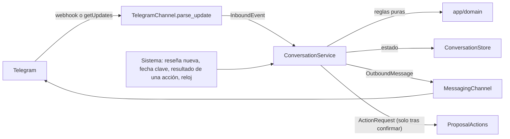

# Canales de mensajería

Base de los canales por los que el agente avisa al dueño y recibe sus respuestas: el motor de propuestas, el orquestador conversacional y el primer canal, Telegram. Fecha: 2026-11-12.

Este documento explica cómo funciona, qué límites aplica y cómo se integra con el resto del sistema. Los textos y botones son los de `docs/fase1/guion-conversacional.md`; los estados, los de `docs/01-flujos.md`.

> **Importante:** Esta entrega no está cableada. Ninguna ruta de la API, ningún job del worker y ninguna tabla de producción la usan todavía. El [plan de integración](#9-plan-de-integración) dice qué hay que tocar y en qué orden.

## 1. Qué hay

| Pieza | Archivo | Qué hace |
|---|---|---|
| Máquina de estados | `app/domain/proposals.py` | Estados y transiciones de una propuesta. Función pura `transition(state, event)` |
| Reglas de conversación | `app/domain/conversation.py` | Horario de silencio, límite semanal, recordatorio y caducidad, cola y prioridad, texto corto, horarios escritos, direcciones vinculadas |
| Mensajes | `app/domain/channel_messages.py` | Mensaje saliente independiente del canal, límites, identificador opaco de botón, evento entrante y catálogo de textos |
| Códigos de vinculación | `app/domain/link_codes.py` | Generación, huella, caducidad e intentos |
| Puertos | `app/ports/messaging.py`, `conversation_store.py`, `proposal_actions.py` | Canal, almacén y puerta por la que una propuesta confirmada se convierte en acción |
| Orquestador | `app/application/conversation_service.py` | `ConversationService`: recibe eventos, aplica las reglas y envía mensajes. Solo usa puertos |
| Telegram | `app/adapters/messaging/telegram.py` | Bot API con `httpx`, webhook y sondeo largo |
| Dobles | `app/adapters/messaging/fake.py`, `app/adapters/conversation_store/memory.py`, `InMemoryProposalActions` | Para pruebas y para la prueba local |
| Ajustes | `app/channels_config.py` | Variables `FICHAITOR_*` |
| Esquema | `db/schema_channels.sql` | Tablas y privilegios |

Principios que se cumplen (`docs/02-hld.md`):

- **El código ejecuta, nadie más.** El orquestador nunca escribe en Google. Cuando el dueño confirma, entrega un `ActionRequest` al puerto `ProposalActions`.
- **Los canales son adaptadores.** El orquestador no sabe si habla por Telegram o por WhatsApp. Solo conoce `channel` y `address`.
- **El texto de terceros es dato.** El texto de una reseña solo se muestra. Ninguna regla lo lee.
- **Sin modelo de lenguaje.** El enrutado es por botones y por palabras exactas. El punto de extensión es `FreeTextRouter`.

## 2. Cómo funciona



Entradas del orquestador:

| Método | Cuándo se llama |
|---|---|
| `handle_inbound(event)` | Llega un mensaje, una pulsación o un `/start` de cualquier chat |
| `submit_review(account_id, ReviewInput)` | Hay una reseña nueva con respuesta propuesta |
| `submit_key_date(account_id, KeyDateInput)` | El planificador decide que toca preguntar por una fecha clave |
| `handle_action_result(proposal_id, ActionOutcome)` y `handle_action_finished(action_id, ...)` | El ejecutor ha terminado la acción |
| `tick()` | Cada pocos minutos: recordatorios, caducidades y lo que esperaba al fin del horario de silencio |
| `create_link_code(account_id)` y `unlink(account_id, identity_id)` | Desde la sesión web |

### Una propuesta activa y cola

Cada cuenta tiene un hilo (`conversation`) con una sola propuesta activa. Las demás esperan en este orden:

1. Reseñas de 1 o 2 estrellas.
2. La propuesta que una de esas reseñas interrumpió (la más reciente primero). Se retoma con `queue.resume` y los botones del mensaje original.
3. El resto, por prioridad (reseñas antes que fechas clave) y antigüedad.

Una reseña de 1 o 2 estrellas interrumpe la propuesta activa, salvo que esa también sea una reseña de 1 o 2 estrellas. Mientras una propuesta espera, sus botones antiguos responden "está en espera" y no hacen nada.

La propuesta deja libre el hilo cuando el dueño confirma (estado `ejecutando`), la descarta, caduca o la lleva al panel.

### Botones

El identificador de cada botón es opaco: `prop_<16 hex>.<testigo de 6 hex>.<opción>`. No lleva el negocio, la reseña ni el cambio. Ocupa 53 bytes como máximo.

Ese identificador **no basta para actuar**. En cada pulsación el orquestador comprueba, en este orden:

1. Que la dirección que pulsa está vinculada, ahora, a la cuenta dueña de la propuesta. Si no, responde lo mismo que a un identificador inexistente.
2. Que la propuesta sigue abierta. Si ya está resuelta, responde `stale.resolved`.
3. Que es la propuesta activa del hilo. Si espera en la cola, responde `queue.wait`.
4. Que el testigo es el del paso vigente y que la opción existe en ese paso. El testigo cambia en cada paso: el botón `Publicar` del mensaje original deja de valer cuando el dueño ha pulsado `Editar`.

### Confirmación

Solo `ConversationService._confirm` pide una acción, y solo se llega a ella desde un evento entrante de una dirección vinculada. La propuesta guarda la confirmación registrada: `confirmed_at`, `confirmed_event_id` y `confirmed_summary`. La base de datos lo exige también: una propuesta no puede estar en `ejecutando`, `aplicada` o `fallida` sin `confirmed_at` y `confirmed_event_id`.

Lo que se confirma es exactamente lo que se mostró:

- `Publicar` envía la respuesta propuesta tal como se guardó y se enseñó. Nunca se recorta: si no cabe con la reseña, se recorta el extracto de la reseña.
- Tras `Editar`, el siguiente texto del dueño es la respuesta. Se le enseña entero (`review.edit_confirm`) y solo `Sí, enviar` crea la acción.
- `Cierro` y `Abro normal` confirman en un toque, porque el mensaje del festivo describe el cambio completo. Un horario escrito a mano pasa siempre por el resumen `change.confirm`.

## 3. Estados de una propuesta

Las 14 transiciones del diagrama de `docs/01-flujos.md`, sección 4, están en `DIAGRAM_TRANSITIONS`. La confirmación en un toque recorre el diagrama entero (`enviada → recopilando → por_confirmar → ejecutando`): no se salta ningún estado.

Se añaden cuatro transiciones que el diagrama no tiene (`EXTRA_TRANSITIONS`):

| Transición | Por qué |
|---|---|
| `enviada → caducada` | El plazo del recordatorio ya no cabe (se envió tarde) |
| `recopilando → caducada`, `por_confirmar → caducada` | El dueño dejó la propuesta a medias. Sin esto bloquearía el hilo para siempre |
| `caducada → programada` | El dueño responde a una propuesta caducada que sigue vigente (flujo 9 del guion) |

Tipos: `review_reply` y `key_date` tienen flujo. `owner_order` ("hoy cierro") existe en el modelo y en la tabla, sin flujo todavía.

## 4. Reglas de frecuencia y de tiempo

| Regla | Valor | Dónde |
|---|---|---|
| Horario de silencio | De 21:00 a 9:00, hora local de la cuenta. Admite horas punta por sector (`QuietHours.busy`) | `is_quiet` |
| Límite semanal | 2 mensajes proactivos en 7 días móviles, sin contar reseñas. Configurable | `under_weekly_cap` |
| Reseña | Recordatorio a las 24 horas; caduca a los 7 días | `review_deadlines` |
| Festivo | Recordatorio 1 día antes; caduca el mismo día (a las 00:00 locales) | `key_date_deadlines` |
| Fecha comercial | Recordatorio 7 días antes; caduca 2 días antes | `key_date_deadlines` |
| Temporada | Recordatorio 10 días antes; caduca al empezar | `key_date_deadlines` |
| Aclaraciones | Dos preguntas; a la tercera, opciones cerradas | `clarification_key` |
| Recordatorios | Uno por propuesta, y solo si el dueño no ha contestado nada | `due_event` |

Al caducar no se envía nada.

El horario de silencio se aplica a todo lo que el agente envía por iniciativa propia: propuestas, recordatorios y propuestas retomadas. No se aplica a las respuestas a algo que el dueño acaba de enviar ni al resultado de un cambio que confirmó.

## 5. Vinculación

La vinculación es la misma para todos los canales. Una identidad de canal es `channel` (`telegram`, `whatsapp`, `email`) y `address` (identificador del chat, teléfono en E.164 o correo).

1. La sesión web pide un código (`create_link_code`). Son 6 dígitos de un solo uso, válidos 10 minutos. Pedir otro invalida el anterior.
2. El dueño envía el código desde su propio chat:
   - Telegram: `https://t.me/FichaitorBot?start=<código>`, o el código escrito en el chat.
   - WhatsApp (cuando exista el adaptador): `https://wa.me/<número de Fichaitor>?text=<código>`. Enviarlo desde su teléfono demuestra que es suyo y abre la ventana de 24 horas.
3. El orquestador valida el código y vincula la dirección a la cuenta.

Reglas, todas con prueba:

- **Solo se atiende a las direcciones vinculadas.** Un mensaje de una dirección sin vincular nunca crea propuestas ni acciones. Recibe `unlinked.reply` con el enlace de alta, una vez cada 24 horas, y ningún dato de ninguna ficha.
- **Una cuenta puede tener varias direcciones** (dueño y encargado), cada una vinculada con su propio código. Las propuestas, los recordatorios y los resultados llegan a todas. Responde quien llegue antes; la otra dirección ve la propuesta como resuelta.
- **Una dirección pertenece a una sola cuenta a la vez.** Vincularla a otra cuenta la desvincula de la anterior, con el aviso `link.moved`.
- **Desvincular desde el panel es inmediato.** Desde ese instante no se le envía nada y sus mensajes se tratan como los de un desconocido.
- **El código no se guarda en claro.** Se guarda su SHA-256, con el secreto `FICHAITOR_LINK_CODE_PEPPER` si está definido. Tampoco se anota en el registro de mensajes ni en los logs.
- **Tres códigos incorrectos seguidos bloquean la dirección una hora.** Durante el bloqueo no se evalúa ningún código ni se responde.

> **Nota:** Seis dígitos son un millón de valores. La huella no protege un código guardado frente a la fuerza bruta: lo protegen los 10 minutos, el uso único y el bloqueo. El secreto opcional cierra también ese hueco.

## 6. Telegram

### Bot y variables

El bot ya existe: `@FichaitorBot` (`https://t.me/FichaitorBot`). Es un solo bot de Fichaitor para todos los clientes. El dueño de un negocio no crea ningún bot.

| Variable | Uso | Secreto |
|---|---|---|
| `FICHAITOR_TELEGRAM_BOT_TOKEN` | Token que da BotFather | Sí |
| `FICHAITOR_TELEGRAM_BOT_USERNAME` | Nombre del bot para los enlaces. Por defecto `FichaitorBot` | No |
| `FICHAITOR_TELEGRAM_WEBHOOK_SECRET` | Secreto del webhook, para producción. De 1 a 256 caracteres: `A-Z`, `a-z`, `0-9`, `_` y `-` | Sí |
| `FICHAITOR_TELEGRAM_POLLING` | `true` para desarrollo local con sondeo largo | No |
| `FICHAITOR_LINK_CODE_PEPPER` | Opcional. Secreto que se mezcla en la huella de los códigos. Lo necesitan la API y el worker con el mismo valor | Sí |
| `FICHAITOR_CHANNELS_PANEL_URL`, `FICHAITOR_CHANNELS_SIGNUP_URL`, `FICHAITOR_CHANNELS_RECONNECT_URL` | Enlaces de los textos. Por defecto, `https://fichaitor.es/app` y `https://fichaitor.es` | No |
| `FICHAITOR_PROACTIVE_WEEKLY_CAP` | Límite semanal. Por defecto 2 | No |
| `FICHAITOR_QUIET_HOURS_START`, `FICHAITOR_QUIET_HOURS_END` | Horario de silencio. Por defecto `21:00` y `09:00` | No |

Si alguna vez hay que crear otro bot (por ejemplo, uno de pruebas): en Telegram, abre `@BotFather`, envía `/newbot`, elige nombre y usuario (de 5 a 32 caracteres, acabado en `bot`) y copia el token. Si un token se filtra, `/token` en BotFather genera otro.

### Qué usa de la Bot API

| Necesidad | Método | Detalle |
|---|---|---|
| Enviar con botones | `sendMessage` | `reply_markup.inline_keyboard`, un botón por fila. Texto plano, sin `parse_mode`, con la vista previa de enlaces desactivada |
| Responder a la pulsación | `answerCallbackQuery` | Siempre, aunque no haya aviso que mostrar |
| Quitar los botones | `editMessageText` | Con el teclado vacío y la línea "Tu respuesta: …" |
| Recibir en producción | `setWebhook` | Con `secret_token` y `allowed_updates: ["message", "callback_query"]` |
| Recibir en local | `getUpdates` | Sondeo largo. Antes hay que llamar a `deleteWebhook` |

`parse_update` traduce una actualización a un evento interno: mensaje de texto, `/start <código>` o pulsación. Devuelve `None` para todo lo demás: grupos y canales, bots, mensajes sin texto (fotos, audios), remitente distinto del chat y otros tipos de actualización.

### Límites verificados

Fuente: [Telegram Bot API](https://core.telegram.org/bots/api), versión 10.4 (9 de noviembre de 2026), consultada el 2026-11-12.

| Límite | Valor | Cita de la documentación |
|---|---|---|
| Texto de `sendMessage` | De 1 a 4.096 caracteres | "Text of the message to be sent, 1-4096 characters after entities parsing" |
| `callback_data` | De 1 a 64 bytes | "Data to be sent in a callback query to the bot when the button is pressed, 1-64 bytes" |
| Aviso de `answerCallbackQuery` | De 0 a 200 caracteres | "Text of the notification. If not specified, nothing will be shown to the user, 0-200 characters." |
| Texto de `editMessageText` | De 1 a 4.096 caracteres | "New text of the message, 1-4096 characters after entity parsing" |
| Secreto del webhook | De 1 a 256 caracteres | "Only characters A-Z, a-z, 0-9, _ and - are allowed." |
| `getUpdates` con webhook | No funciona | "This method will not work if an outgoing webhook is set up." |
| Actualizaciones pendientes | 24 horas | "they will not be kept longer than 24 hours" |
| Parámetro de `?start=` | Hasta 64 caracteres | "A-Z, a-z, 0-9, _ and - are allowed." ([Bot features](https://core.telegram.org/bots/features#deep-linking)) |
| Ritmo de envío | 1 mensaje por segundo y chat; unos 30 por segundo en total | "In a single chat, avoid sending more than one message per second." ([Bots FAQ](https://core.telegram.org/bots/faq)) |

Sin confirmar:

- **Número máximo de botones y longitud del título.** La documentación no los fija. El adaptador aplica topes propios: 8 botones y 64 caracteres. Los mensajes de la conversación nunca pasan de 3 botones ni de 20 caracteres, por el límite de WhatsApp.
- **El ritmo de envío no se controla todavía.** Un error 429 se trata como temporal y lleva el `retry_after` que indica Telegram.

### El token

La Bot API lleva el token en la ruta (`/bot<token>/<método>`). Para que no salga a ningún log:

- Ningún error del adaptador lleva la URL, el cuerpo de la respuesta ni el texto de la excepción de `httpx`. Solo el método y el código de estado. La excepción original se descarta con `from None`.
- `redact_bot_token_in_logs()` añade un filtro a los loggers `httpx` y `httpcore`, que escriben cada URL en nivel INFO. Hay que llamarla una vez al arrancar. El worker ya baja `httpx` a WARNING en `app/worker/log.py`; el filtro es la segunda barrera.
- El token es `SecretStr` en los ajustes y no aparece en el `repr` del canal.

### Mensaje independiente del canal

`OutboundMessage` tiene la forma de `docs/03-lld.md`: `to`, `kind`, `text`, `buttons` (`id` y `title`) y `template_fallback`. `validate` exige a todos los mensajes el límite más estricto de cada canal, para que sirvan también en WhatsApp:

| Límite | WhatsApp | Telegram | Se aplica |
|---|---|---|---|
| Cuerpo | 1.024 | 4.096 | 1.024 |
| Botones | 3 | Sin límite documentado | 3 |
| Título de botón | 20 | Sin límite documentado | 20 |
| Identificador de botón | 256 | 64 bytes | 64 bytes |

Los límites de WhatsApp son los de `docs/fase0/whatsapp.md`.

## 7. Probarlo en local con sondeo largo

Con el sondeo largo no hace falta URL pública. Todo lo demás va en memoria: no se toca la base de datos ni Google.

1. Define las variables en tu entorno o en `.env`:

   ```text
   FICHAITOR_TELEGRAM_BOT_TOKEN=<token de BotFather>
   FICHAITOR_TELEGRAM_POLLING=true
   ```

2. Arranca la prueba:

   ```bash
   uv run python -m app.adapters.messaging.telegram
   ```

3. Abre el enlace `https://t.me/FichaitorBot?start=<código>` que imprime la consola y pulsa **Iniciar**.

   El bot te da la bienvenida y envía una reseña de ejemplo. Al resolverla, envía un festivo de ejemplo.

4. Responde con los botones o con texto. La consola imprime cada acción confirmada y simula que Google la acepta.

> **Precaución:** Si el bot tiene un webhook configurado, la prueba lo borra (`deleteWebhook`). No la ejecutes con el token de producción mientras producción reciba por webhook. Usa un bot de pruebas.

Pruebas automáticas, sin red:

```bash
uv run pytest -q tests/test_proposals.py tests/test_conversation_rules.py tests/test_conversation_service.py tests/test_channel_messages.py tests/test_channel_config.py tests/test_telegram.py tests/test_link_codes.py
```

## 8. Tablas

`db/schema_channels.sql` es idempotente y se aplica después de `schema.sql` y `schema_worker.sql`.

| Tabla | Contenido | API | Worker |
|---|---|---|---|
| `channel_identity` | Direcciones vinculadas. Desvincular pone `unlinked_at`. Índice único: una dirección activa por canal | Lee; cambia solo `unlinked_at` | Lee, crea y anota actividad |
| `link_code` | Huella del código, cuenta, caducidad y uso | Crea y retira los anteriores. No lee las huellas | Busca por huella y consume |
| `channel_sender` | Direcciones sin vincular, por huella: intentos, bloqueo y última respuesta genérica | Nada | Lee y escribe |
| `proposal` | Propuestas con su estado, paso, testigo y confirmación registrada | Lee | Crea y mueve. No puede cambiar la cuenta, el tipo, el origen ni `payload` |
| `conversation` | Un hilo por cuenta con la propuesta activa | Nada | Lee, crea y cambia la propuesta activa |
| `channel_inbound_event` | Eventos entrantes ya vistos: el mismo se atiende una vez | Nada | Lee y escribe |
| `channel_message` | Mensajes en los dos sentidos. Solo se añaden | Nada | Solo inserta |

Nadie tiene `DELETE`. El worker recibe además lectura de `account (id, selected_location_id)` y `location (id, account_id, title)` para el nombre del negocio en la bienvenida.

Datos personales: la dirección en `channel_identity` y el contenido de `channel_message` (lo que escribe el dueño y el extracto de la reseña). Falta decidir el plazo de conservación de `channel_message` y de `channel_inbound_event`, y añadirlo a `docs/legal/privacidad.md`.

## 9. Plan de integración

Lo que hay que tocar fuera de esta entrega, en orden. Cada paso se puede desplegar por separado.

### Paso 0. Decidir quién crea la acción

Hoy la acción la crea la API (`GRANT INSERT ... ON action TO fichaitor_api`) y el worker no puede crearla, a propósito. La conversación tiene que ejecutarse fuera de la API, porque envía mensajes a Telegram. Hay dos opciones:

| Opción | Cambio | Coste |
|---|---|---|
| **A. Proceso propio (recomendada)** | Un tercer rol `fichaitor_conversation` y un proceso `python -m app.worker --role conversation` que solo atiende los jobs de canal. Tiene `INSERT` en `action` y las tablas de canales; no tiene la clave privada ni lee `google_connection` | Un contenedor más. Mantiene la separación: quien habla con el dueño no puede ejecutar, y quien ejecuta no puede crear acciones |
| B. En el worker actual | `GRANT INSERT (account_id, type, google_sub, location, review_id, text, confirmed_at) ON action TO fichaitor_worker` y permitir al worker el evento `reply_confirmed` en la política de `audit_log` | Ninguno de operación, pero el worker pasa a poder crear y ejecutar acciones |

Con la opción A, los privilegios que `db/schema_channels.sql` da a `fichaitor_worker` pasan a `fichaitor_conversation`.

### Paso 1. Base de datos

1. Aplica `db/schema_channels.sql` en desarrollo y fusiónalo en el esquema del responsable.
2. Amplía la restricción de `action.type` con `set_special_hours` cuando exista su ejecutor (paso 7). Hasta entonces, los festivos se pueden proponer pero no ejecutar.

### Paso 2. Adaptador de PostgreSQL

Crea `app/adapters/conversation_store/postgres.py` con la clase `PostgresConversationStore`, que implementa `app/ports/conversation_store.py`. Puntos que no son evidentes:

- `lock(account_id)`: una transacción con `INSERT INTO conversation ... ON CONFLICT DO NOTHING` y `SELECT ... FROM conversation WHERE account_id = $1 FOR UPDATE`. Todo lo que hace el orquestador dentro del bloqueo va en esa transacción.
- `consume_link_code`: `UPDATE link_code SET used_at = $2 WHERE code_hash = $1 AND used_at IS NULL AND expires_at > $2 RETURNING account_id`.
- `link_identity`: en una transacción, `UPDATE channel_identity SET unlinked_at = $now WHERE channel = $1 AND address = $2 AND unlinked_at IS NULL AND account_id <> $3 RETURNING account_id` y después el `INSERT`.
- `record_inbound`: `INSERT ... ON CONFLICT DO NOTHING` y devolver si insertó.
- `add_proposal`: `INSERT ... ON CONFLICT (account_id, type, source_ref) DO NOTHING`.
- `get_account_info`: `location.title` de `account.selected_location_id`. La zona horaria no existe todavía en `account`: devuelve `Europe/Madrid` hasta que exista.
- Pruebas en `tests/test_conversation_store_postgres.py`, con el mismo guion que `tests/test_conversation_service.py` contra la base de pruebas.

### Paso 3. Rutas de la API

Archivo nuevo `app/api/channels.py`, incluido desde `create_app` en `app/api/main.py`:

| Ruta | Qué hace |
|---|---|
| `POST /api/v1/channels/link-code` | Con sesión. Llama a `link_codes.new_link_code(account_id, now, pepper)`, guarda el registro (método nuevo `Store.save_link_code`, que retira los anteriores) y responde `{"code", "expires_at", "telegram_url"}` con `ChannelsSettings.telegram_link(code)`. Límite: 5 códigos por cuenta y hora, con `SlidingWindowLimiter` |
| `GET /api/v1/me/channels` | Con sesión. Lista las direcciones activas, con la dirección enmascarada |
| `DELETE /api/v1/me/channels/{id}` | Con sesión. `UPDATE channel_identity SET unlinked_at = now() WHERE id = $1 AND account_id = $2 AND unlinked_at IS NULL` |
| `POST /api/v1/webhooks/telegram` | Sin sesión. Ver abajo |

El webhook, en este orden:

1. Si `telegram.verify_webhook_secret(request.headers.get("X-Telegram-Bot-Api-Secret-Token"), secret)` es falso, responde 403 sin leer el cuerpo. Sin secreto configurado, la ruta no se registra.
2. Limita el cuerpo a 64 KB y léelo como JSON.
3. Si `telegram.parse_update(update)` devuelve `None`, responde 200 y no encola nada.
4. Encola un job `channel_inbound` con `payload={"channel": "telegram", "update": update}` e `idempotency_key=f"telegram:{update_id}"`. Responde 200.

La API no llama a Telegram: valida, guarda y encola (`docs/02-hld.md`).

Añade a `GRANT INSERT ... ON job TO fichaitor_api` lo que ya tiene; no hace falta más.

### Paso 4. Jobs del worker

En `app/worker/`, registrados en `build_registry` de `app/worker/__main__.py`:

| Job | Archivo nuevo | Qué hace |
|---|---|---|
| `channel_inbound` | `app/worker/channel_inbound.py` | `event = telegram.parse_update(job.payload["update"])` y `await service.handle_inbound(event)`. Al terminar, vacía `payload` del job: puede llevar un código de vinculación |
| `conversation_tick` | `app/worker/conversation_tick.py` | `await service.tick()` |
| `propose_review` | `app/worker/propose_review.py` | Ver el paso 5 |
| `plan_key_dates` | `app/worker/plan_key_dates.py` | Ver el paso 6 |
| `channel_action_result` | `app/worker/channel_action_result.py` | `await service.handle_action_finished(action_id, ActionOutcome(...))` |

Construcción del servicio, una vez al arrancar:

```python
settings = ChannelsSettings()
telegram.redact_bot_token_in_logs()
channel = TelegramChannel(settings.telegram_bot_token.get_secret_value(), http_client)
service = ConversationService(
    PostgresConversationStore(pool),
    {"telegram": channel},
    ReviewReplyActions(store),  # paso 7
    settings.service_config(),
    clock=lambda: datetime.now(UTC),
)
```

Con `FICHAITOR_TELEGRAM_POLLING=true`, el proceso lanza además `telegram.poll(channel, service.handle_inbound)` como tarea, en lugar de recibir por webhook.

En producción, una vez por despliegue: `await channel.set_webhook("https://fichaitor.es/api/v1/webhooks/telegram", secret)`.

### Paso 5. Detección de reseñas nuevas

Hoy `WorkerStore.save_reviews` no dice qué reseñas son nuevas.

1. Cambia `save_reviews` para que devuelva los identificadores (`rev_…`) de las reseñas insertadas en esa llamada que no tienen respuesta.
2. En `SyncProfile.__call__` (`app/worker/sync_profile.py`), después de `save_reviews`, encola un job `propose_review` por cada una, con `idempotency_key=f"propose_review:{review_id}"`. Igual que `SentimentTrigger.after_sync`, nunca lanza.
3. No propongas el histórico: solo reseñas con `created_at` de los últimos 7 días y posteriores a la primera vinculación de la cuenta.
4. El job `propose_review`: busca las cuentas con dirección vinculada cuya ficha elegida es esa; pide el borrador a `ReplyWriter.write_reply(stars, text)`, lo pasa por `validate_reply` y llama a `service.submit_review(account_id, ReviewInput(review_id, stars, text, reply))`.
5. Si no hay borrador válido, la reseña no se propone por el canal: queda en el panel. Una variante sin respuesta propuesta (solo `Editar` y `No responder`) queda pendiente.

`submit_review` es idempotente por reseña: llamarlo dos veces no crea dos propuestas.

### Paso 6. Planificador periódico

Hoy la sincronización solo ocurre cuando el dueño abre el panel. Sin un planificador no hay reseñas nuevas que avisar.

Añade en `app/worker/__main__.py` una tarea `planner` que, cada minuto, encola con clave de idempotencia por franja. Así, varios workers no duplican el trabajo:

| Job | Cadencia | Clave de idempotencia |
|---|---|---|
| `conversation_tick` | Cada 5 minutos | `conversation_tick:<franja de 5 min>` |
| `sync_profile` de cada ficha elegida con dirección vinculada | Cada 30 minutos, de 8:30 a 21:00; cada 3 horas por la noche | `sync:<google_sub>:<location>:<franja>` |
| `plan_key_dates` | Una vez al día, a las 9:05 | `plan_key_dates:<fecha>` |

Treinta minutos es el compromiso propuesto entre "al momento" y la cuota de la API de reseñas. Hay que contrastarlo con `docs/fase0/matriz-api.md` antes de fijarlo. Cuando existan las notificaciones de Google (Pub/Sub), la sincronización periódica pasa a ser el respaldo.

El job `plan_key_dates`, por cada cuenta con dirección vinculada: construye `calendar.Business`, llama a `calendar.due_proposals(business, today, calendar, already_proposed)` y, por cada `KeyDate`, a `service.submit_key_date(account_id, KeyDateInput(key=item.key, kind=item.kind, day=item.date, name=item.name))`. `already_proposed` sale de `proposal.source_ref`.

### Paso 7. Conectar `proposal_actions` con las acciones existentes

Crea `app/adapters/proposal_actions/review_replies.py`:

```python
class ReviewReplyActions:
    def __init__(self, store: Store, clock) -> None: ...

    async def create(self, request: ActionRequest) -> ActionReceipt:
        if request.type != "reply_review":
            raise ActionRejected(REJECT_UNAVAILABLE)  # set_special_hours: sin ejecutor aún
        try:
            text = check_owner_reply(request.payload["text"])
        except InvalidReplyText:
            raise ActionRejected(REJECT_INVALID) from None
        try:
            action_id = await store.create_reply_action(
                request.account_id, request.payload["review_id"], text, request.confirmed_at
            )
        except ReplyInProgress:
            raise ActionRejected(REJECT_UNAVAILABLE) from None
        if action_id is None:
            raise ActionRejected(REJECT_TARGET_GONE)
        return ActionReceipt(action_id, created=True)
```

- `Store.create_reply_action` ya crea la acción, la fila de auditoría y el job `reply_review`, todo o nada. Ya comprueba que la reseña es de la ficha elegida de esa cuenta: es la segunda barrera de pertenencia.
- El índice `action_one_live_per_review` impide dos respuestas en vuelo para la misma reseña.
- Para avisar del resultado, `ReplyReview` (`app/worker/reply_review.py`) encola `channel_action_result` con `{"action_id", "ok", "error"}` después de `finish_action` y dentro de `_fail`. Los códigos se traducen así: `review_gone` a `target_gone`, `reconnect` a `reconnect`, el resto a fallo genérico.
- Conviene añadir a `audit_log` el canal y el evento que confirmaron (`request.confirmed_channel`, `request.confirmed_event_id`).

El ejecutor de `set_special_hours` no existe. Hasta que exista, deja desactivadas las propuestas de fecha clave (no registres `plan_key_dates`).

### Paso 8. Variables y documentación

Añade a `.env.example`:

```text
# Canales de mensajería (docs/canales.md). Un solo bot de Fichaitor: @FichaitorBot.
FICHAITOR_TELEGRAM_BOT_TOKEN=
FICHAITOR_TELEGRAM_BOT_USERNAME=FichaitorBot
# Producción: secreto del webhook (A-Z, a-z, 0-9, _ y -; hasta 256 caracteres).
FICHAITOR_TELEGRAM_WEBHOOK_SECRET=
# true: desarrollo local con sondeo largo, sin URL pública.
FICHAITOR_TELEGRAM_POLLING=false
# Opcional. Secreto que se mezcla en la huella de los códigos de vinculación.
FICHAITOR_LINK_CODE_PEPPER=
```

Actualiza `docs/contrato-web-api.md` con las tres rutas de canales y `docs/worker.md` con los jobs nuevos.

## 10. Decisiones tomadas

Las que no venían dictadas. Las tres primeras se apartan del guion.

| Decisión | Motivo |
|---|---|
| Los mensajes de reseña no nombran al autor | El nombre no se guarda (`db/schema_worker.sql`). `Nueva reseña de {autor}, …` pasa a `Nueva reseña, …` |
| Tras `Editar`, el texto del dueño se confirma antes de enviarse | Lo exige el encargo. El guion lo enviaba "sin más preguntas" |
| `link.moved` sustituye a `link.already_linked` | Decisión del propietario (2026-11-12): vincular una dirección a otra cuenta la mueve, con aviso |
| Textos nuevos: `stale.resolved`, `stale.inactive`, `queue.wait`, `review.edit_too_long`, `link.moved` y `fmt.choice` | El guion no tiene texto para una pulsación tardía, una respuesta que no cabe o un botón ya usado. Hay que revisarlos con el tono del guion |
| `{canal}` y `{este_chat}` en `unlinked.reply` | El guion decía "WhatsApp" y "Este número" |
| Una reseña de 1 o 2 estrellas se salta la cola, **no** el horario de silencio | `docs/04-ux-conversacional.md`: "Reseña: al momento (en horario)" y "nada entre las 21:00 y las 9:00" |
| Se adelantan las reseñas de 1 o 2 estrellas; el texto "negativo" lo llevan las de 1 a 3 | El encargo fija la prioridad en 1 o 2 estrellas. El guion usa el texto de 2b para 1 a 3 |
| El límite semanal cuenta propuestas enviadas por primera vez en 7 días móviles | Un recordatorio pertenece a una propuesta ya contada |
| Una propuesta aplazada por el límite se cancela si llega su caducidad | "Deja de ser relevante" |
| Una pulsación tardía sobre una propuesta caducada la reabre y la vuelve a mostrar; no confirma nada | Cumple el flujo 9 y el invariante de que una pulsación tardía no crea una acción |
| "sí" y "no" ante "¿Abres?" no confirman nada: llevan a opciones cerradas | "No" puede ser "cierro" o "déjalo". No se supone |
| Un horario que no abre antes de cerrar ("de 9 a 2") no se interpreta | "Nunca se supone" (`docs/01-flujos.md`, excepciones). Los horarios que pasan de medianoche quedan para el panel |
| `Abro normal` crea la acción `{"date", "regular": true}` | El ejecutor resuelve el horario habitual de ese día. Amplía la carga de `set_special_hours` del LLD |
| La rama `Tengo oferta` no está | El guion la retira si los posts no entran en el MVP. No hay acción `create_post` |
| Un hilo por cuenta, no por dirección | Con dueño y encargado vinculados, la propuesta activa es una sola. Se aparta de `conversation(channel_identity_id)` del LLD |
| Zona horaria con la regla de la UE escrita en el dominio | `zoneinfo` no trae datos en Windows sin el paquete `tzdata`, y no se podían añadir dependencias |
| Seis dígitos de una dirección vinculada son un código, salvo que una propuesta espere un texto | En WhatsApp el código llega como texto normal |

## 11. Pendiente

- Flujos del guion sin implementar: bienvenida con primera mejora (flujo 1), varias reseñas en un día (`review.digest`), dos festivos seguidos (`holiday.ask_multi`), "hoy cierro" (flujo 5), experto (6), mejoras (7), reconexión proactiva (10), resumen semanal (11) y el menú `fallback.options` (12). Con un texto no entendido y sin propuesta abierta, el agente responde `fallback.first`, después `fallback.other`, y después calla.
- `review.edit_warn` (datos personales, insultos u ofertas en la respuesta del dueño) y `Reintentar` tras `google.failed`.
- Audios y fotos: `parse_update` los ignora.
- Agrupar un festivo y una fecha comercial de la misma semana en un mensaje.
- Si el bot está bloqueado por el dueño (error 403), la propuesta se queda en `programada` y se reintenta en cada `tick` hasta caducar. Falta marcar la dirección como inalcanzable y avisar en el panel.
- Adaptador de WhatsApp. El modelo y las reglas ya no dependen de Telegram; faltan la ventana de 24 horas y las plantillas (`template_fallback`).
- Enlaces como botón de URL en Telegram (`Ver ficha`, `Abrir panel`). Hoy van en el texto.
